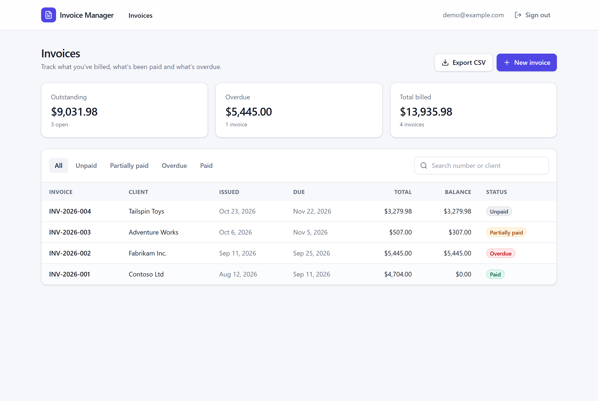
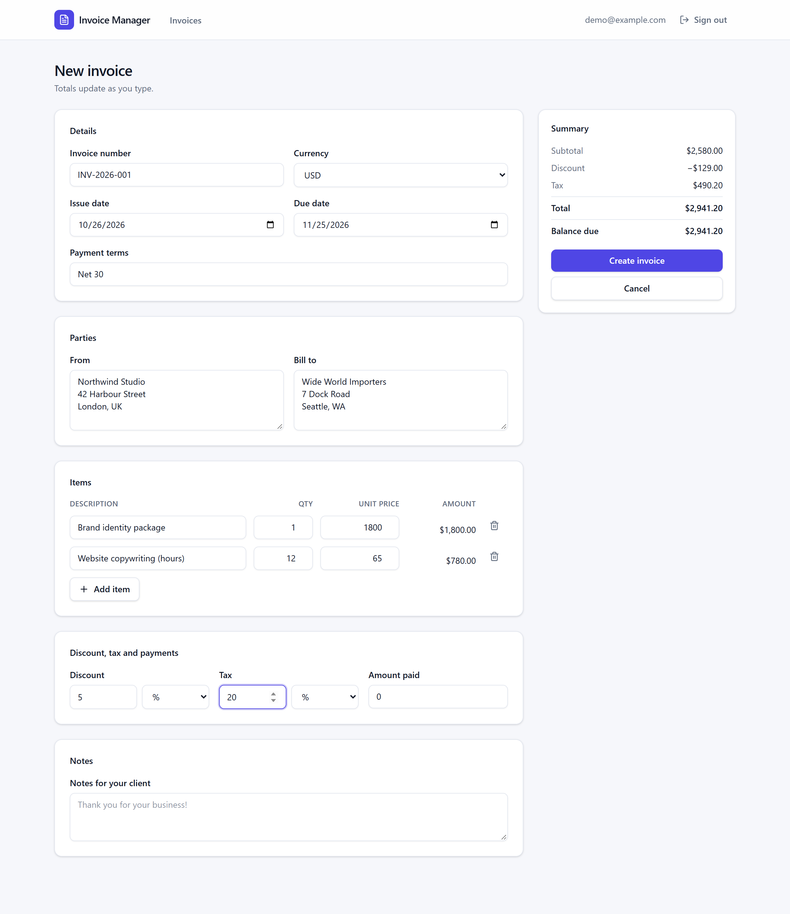
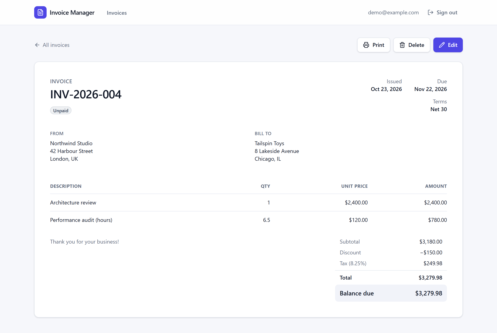
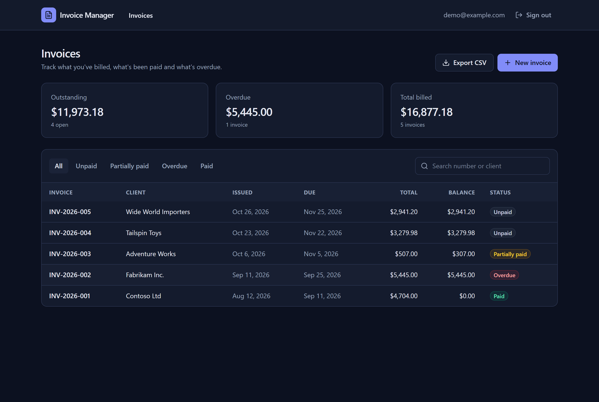
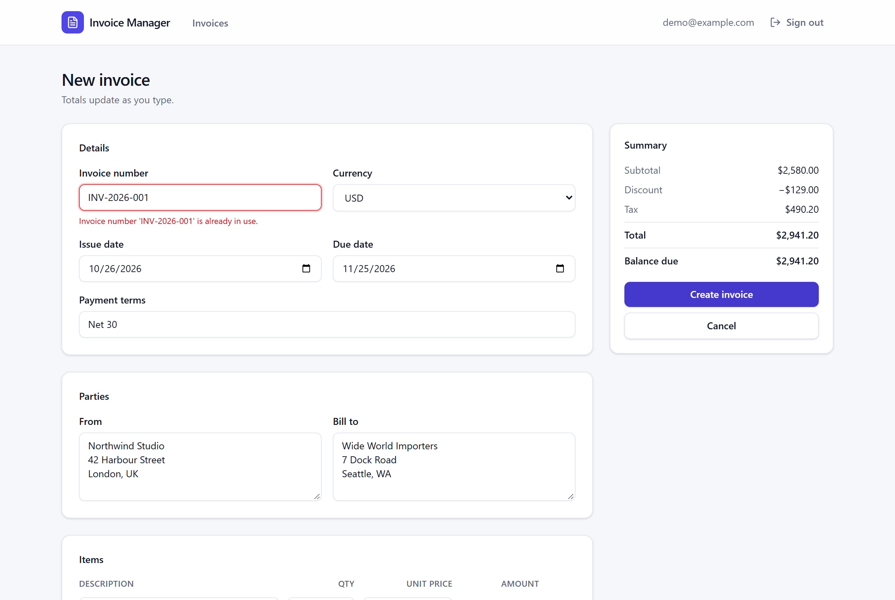
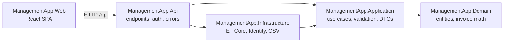

# Invoice Manager

[](https://github.com/dejanciev-dev/invoice-management-app/actions/workflows/ci.yml)


[](LICENSE)

A full-stack invoicing app for freelancers and small businesses. You can create invoices with line items, discounts and tax, track what's paid and what's overdue, print them, and export everything to CSV.

The backend is an **ASP.NET Core 10** API built with **Clean Architecture**. The frontend is a **React 19 + TypeScript** single-page app. Both are covered by unit and integration tests and built by CI.



<table>
  <tr>
    <td></td>
    <td></td>
  </tr>
  <tr>
    <td></td>
    <td></td>
  </tr>
</table>

## Features

- **Invoices with line items:** percentage or flat discount and tax, partial payments and multiple currencies.
- **Calculated totals and status:** subtotal, discount, tax, total, balance due and status (Unpaid, Partially paid, Paid, Overdue) are calculated in the domain model, so the API and UI always agree.
- **Live preview:** the editor recalculates totals as you type, using the same half-away-from-zero rounding as the server.
- **Search, status filters and dashboard stats:** outstanding, overdue and total billed, summed per currency.
- **CSV export** and a **print-friendly invoice view.**
- **Accounts:** registration and sign-in with ASP.NET Core Identity. Each user only ever sees their own invoices.
- **Helpful errors:** validation runs on the client (Zod) and the server (FluentValidation). Server errors such as a duplicate invoice number appear next to the field they refer to.
- **Responsive** layout with **light and dark** themes.

## Tech stack

| Area | Technologies |
| --- | --- |
| API | .NET 10, ASP.NET Core minimal APIs, ASP.NET Core Identity (cookie and bearer auth), OpenAPI with Scalar UI, ProblemDetails (RFC 9457), health checks |
| Data | Entity Framework Core 10, SQL Server; SQLite for tests |
| Application | Use-case handlers, FluentValidation, `TimeProvider`, CsvHelper |
| Web | React 19, TypeScript 6 (strict), Vite 8, Tailwind CSS 4, React Router, TanStack Query, React Hook Form, Zod |
| Testing | xUnit v3, Shouldly, `WebApplicationFactory`, Vitest, Testing Library |
| Tooling | GitHub Actions, Dependabot, Docker, central package management, nullable reference types with warnings as errors |

## Architecture

The solution follows Clean Architecture: dependencies point inwards, and the domain has no dependencies at all.



| Project | Responsibility |
| --- | --- |
| `ManagementApp.Domain` | `Invoice` and `InvoiceItem` entities. The money calculations and status rules live here and are fully unit tested. |
| `ManagementApp.Application` | One handler per use case (create, update, delete, get, list, export), validators, DTOs and the interfaces Infrastructure implements. |
| `ManagementApp.Infrastructure` | EF Core `DbContext`, entity configurations, migrations, Identity, CSV export, audit fields and database seeding. |
| `ManagementApp.Api` | Minimal API endpoint groups, the exception-to-ProblemDetails mapping and the current-user service. In production it also serves the built SPA. |
| `ManagementApp.Web` | The React front-end. |

### Design decisions

- **Plain handlers instead of MediatR and AutoMapper.** Each use case is a small class injected straight into its endpoint, and mapping is explicit. This keeps the code easy to follow and debug, with no reflection and no commercial-license dependencies.
- **Money is `decimal`, rounded once, in one place.** Line amounts and percentage discounts and taxes are rounded to two decimals, half away from zero. The front-end reproduces the same rules for its live preview, and tests on both sides pin the expected values.
- **Status is calculated, not stored.** "Overdue" depends on today's date, so it is derived from the due date, total and amount paid using an injectable `TimeProvider`. This makes it deterministic in tests.
- **Ownership is enforced in queries.** Every query is scoped to the current user's `OwnerId`, and other users' invoices return `404`, not `403`, so their IDs are never revealed.
- **Integration tests use real HTTP and a real relational database.** The API tests sign up users through the Identity endpoints and run against in-memory SQLite with the real schema.

## Getting started

### Option 1: Docker (everything in one command)

```bash
docker compose up --build
```

Open <http://localhost:8080> and click **Try the demo account** (`demo@example.com` / `Demo123!`). This starts SQL Server and the app, applies migrations and seeds sample invoices.

### Option 2: Run locally

Prerequisites: [.NET 10 SDK](https://dotnet.microsoft.com/download), [Node.js 22.12+](https://nodejs.org/) and SQL Server. On Windows, the LocalDB instance that ships with Visual Studio works with the default connection string. Elsewhere, set `ConnectionStrings__DefaultConnection`.

```bash
# 1. API on http://localhost:5080 (applies migrations and seeds the demo account in Development)
dotnet run --project src/ManagementApp.Api --launch-profile http

# 2. Web app on http://localhost:5173 (proxies /api to the API)
cd src/ManagementApp.Web
npm install
npm run dev
```

The interactive API reference is at <http://localhost:5080/scalar> in Development.

## Running the tests

```bash
dotnet test --solution ManagementApp.slnx   # domain, application, infrastructure and API tests

cd src/ManagementApp.Web
npm test                                    # front-end unit and component tests
npm run lint && npm run typecheck
```

## API overview

All invoice endpoints require authentication and return [problem details](https://www.rfc-editor.org/rfc/rfc9457) on errors.

| Method | Route | Description |
| --- | --- | --- |
| `POST` | `/api/auth/register` | Create an account |
| `POST` | `/api/auth/login?useCookies=true` | Sign in (cookie), or omit `useCookies` to get a bearer token |
| `POST` | `/api/auth/logout` | Sign out |
| `GET` | `/api/auth/manage/info` | The signed-in user |
| `GET` | `/api/invoices?search=&status=` | List invoices (summaries) |
| `GET` | `/api/invoices/{id}` | Invoice with items and totals |
| `POST` | `/api/invoices` | Create an invoice |
| `PUT` | `/api/invoices/{id}` | Update an invoice |
| `DELETE` | `/api/invoices/{id}` | Delete an invoice |
| `GET` | `/api/invoices/export` | Download all invoices as CSV |
| `GET` | `/health` | Health check (includes the database) |

## Project structure

```
├── src
│   ├── ManagementApp.Domain           # entities and invoice math
│   ├── ManagementApp.Application      # use-case handlers, validation, DTOs
│   ├── ManagementApp.Infrastructure   # EF Core, Identity, CSV, migrations
│   ├── ManagementApp.Api              # minimal API host
│   └── ManagementApp.Web              # React + Vite front-end
├── tests
│   ├── ManagementApp.Domain.UnitTests
│   ├── ManagementApp.Application.UnitTests
│   ├── ManagementApp.Infrastructure.IntegrationTests
│   └── ManagementApp.Api.IntegrationTests
├── Dockerfile
├── compose.yaml
└── ManagementApp.slnx
```

## License

[MIT](LICENSE) © Dejan Ciev
