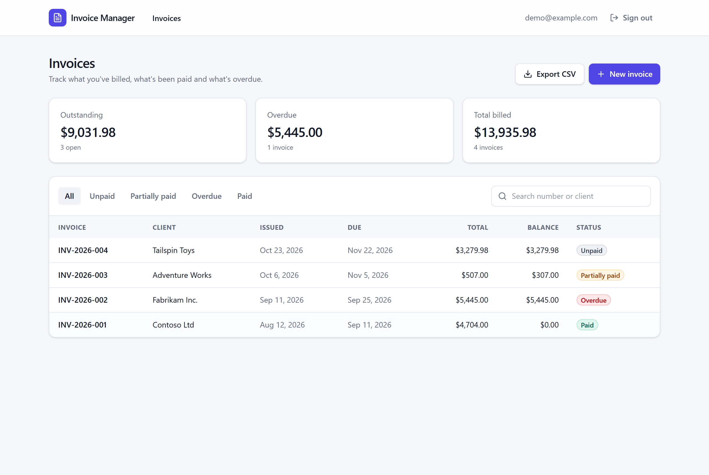
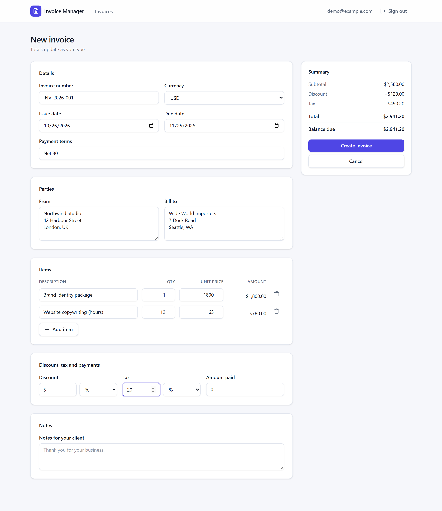
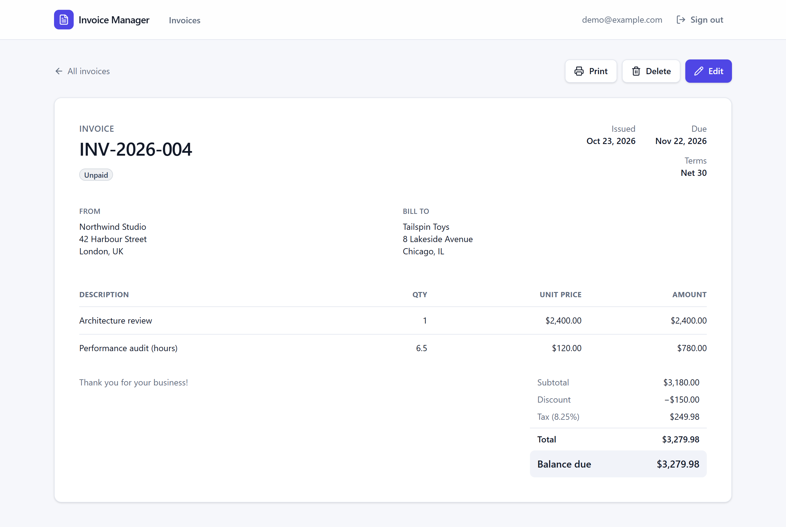
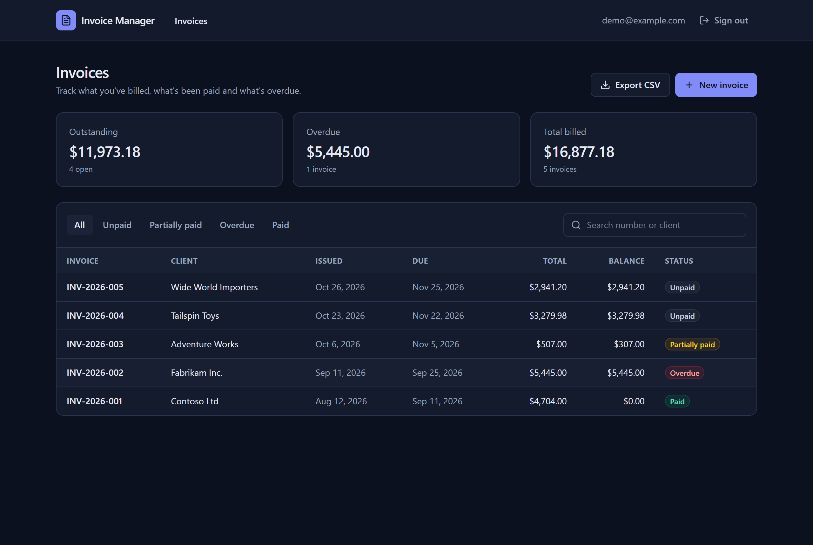
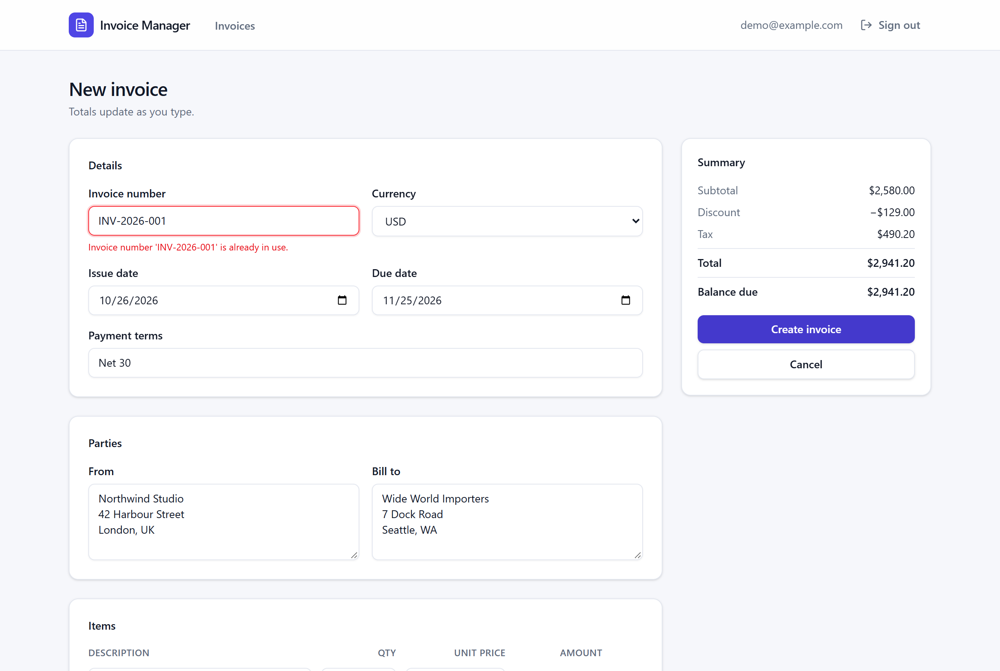
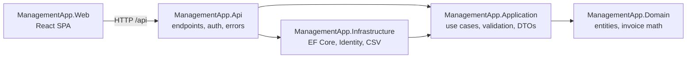

# Invoice Manager

[](https://github.com/dejanciev-dev/invoice-management-app/actions/workflows/ci.yml)


[](LICENSE)

A multi-tenant invoicing SaaS for small businesses. Each company (tenant) has its own users, roles, invoices, numbering, branding and settings, fully isolated from every other company. Companies create invoices with line items, discounts and tax, track what's paid and what's overdue, print them and export them to CSV. A separate platform admin area manages tenants, subscriptions and users, and lets support staff impersonate a user, with every step audited.

The backend is an **ASP.NET Core 10** API built with **Clean Architecture**. The frontend is a **React 19 + TypeScript** single-page app. Both are covered by unit and integration tests and built by CI.



<table>
  <tr>
    <td></td>
    <td></td>
  </tr>
  <tr>
    <td></td>
    <td></td>
  </tr>
</table>

## Features

- **Invoices with line items:** percentage or flat discount and tax, partial payments and multiple currencies.
- **Calculated totals and status:** subtotal, discount, tax, total, balance due and status (Draft, Unpaid, Partially paid, Paid, Overdue, Credited, Void) are calculated in the domain model, so the API and UI always agree.
- **Live preview:** the editor recalculates totals as you type, using the same half-away-from-zero rounding as the server.
- **Invoice lifecycle:** new invoices are drafts that can be edited or deleted. Issuing one makes it final: it can no longer be edited or deleted, only have payments recorded or be voided with a reason, so it stays on record. Drafts and void invoices are left out of outstanding, overdue and billed totals and of overdue reminders. Every transition is audited. Invoices that existed before the lifecycle were marked issued when upgrading.
- **Payments:** each payment on an issued invoice is recorded with its amount, date, method (bank transfer, card, cash, cheque, other) and reference, and listed in the invoice's payment history. Payments cannot exceed the balance due or be dated in the future, and a payment recorded by mistake can be deleted while the invoice is issued. If two people record payments on the same invoice at the same moment, the second is refused instead of overpaying it. Amounts paid before upgrading became one payment each.
- **Credit notes:** issued invoices are corrected with credit notes instead of edits. A credit note reduces the balance due by an amount (including tax, with the tax part split out in the invoice's proportion), has a reason and its own gap-free number (prefix `CN-` by default, set in the settings), and is final. An invoice whose balance was cleared only by credit notes shows as **Credited**, billed totals are shown net of credit notes, and an invoice with credit notes can no longer be voided.
- **Gap-free invoice numbering:** drafts have no number. Issuing takes the next number from the company's sequence (prefix, running number, padding) inside the same transaction, so issued numbers are consecutive even when several people issue at once, and a failed issue gives its number back. The next number can be moved forward in the settings, and back only together with a new prefix (e.g. a new year's series).
- **Search, status filters and dashboard stats:** outstanding, overdue and total billed, summed per currency.
- **CSV export**, a **print-friendly invoice view** and **branded PDFs** (logo, brand colour, sender details, tax label and footer). An issued invoice's PDF is made when it is issued, stored, and served unchanged from then on, so reprints match what the client received; drafts and void invoices are marked DRAFT or VOID.
- **Customers:** contact details, billing address, tax number, and their own default currency and payment terms (falling back to the company's). Picking a customer in the invoice editor fills in "Bill to", currency, terms and due date; the invoice keeps its own copy of those details. Each customer's page lists their invoices. Deleting a customer only hides it, so invoice history stays intact. Existing invoices were linked to customers created from their "Bill to" text when upgrading.
- **Products & services catalogue:** name, unit (hour, month, ...) and usual price. "Add from catalogue" in the invoice editor adds one as a line; the invoice keeps its own copy, so changing or deleting a product never alters existing invoices.
- **Email with delivery status:** emails (invitations, overdue reminders, and soon invoices) are queued in an outbox in the same transaction as the change that causes them, then sent by a background worker with the company's name as sender and its reply-to address. Failed sends are retried after 1, 5, 15 and 60 minutes; the **Emails** page shows what was sent, what is waiting and what failed and why, and failed emails can be retried.
- **Multi-tenant:** self-service sign-up creates a company on a 14-day trial. Users can belong to several companies and switch between them. Data is isolated on the server, never just hidden in the UI.
- **Roles and permissions:** Tenant Admin, Manager, Accountant and Employee, each with default permissions that admins can adjust per user. Users join by invitation link or are created by an admin.
- **Company settings:** profile, tax/VAT details, invoice numbering (prefix, next number, padding), default currency, payment terms and tax rate, logo, brand colour, invoice footer, email and notification preferences.
- **Platform admin area:** dashboard, tenant management (create, edit, activate, deactivate, suspend, delete with safeguards), subscription plans and limits, global user management and platform-wide activity.
- **Impersonation:** platform admins can use the app as a tenant user for support, without ever seeing a password. A banner is shown throughout, it ends automatically after an hour, and every action is recorded against the admin.
- **Audit log:** sign-ins, invoice and payment changes, user and permission changes, tenant changes and impersonation. Tenant admins see their own company's log; platform admins see everything.
- **Subscription-ready:** plans with user and invoice limits and plan features, trials and expiry (read-only when expired). No payment provider is wired in yet.
- **Helpful errors:** validation runs on the client (Zod) and the server (FluentValidation). Server errors such as a duplicate invoice number appear next to the field they refer to.
- **Responsive** layout with **light and dark** themes.

## Tech stack

| Area | Technologies |
| --- | --- |
| API | .NET 10, ASP.NET Core minimal APIs, ASP.NET Core Identity (cookie and bearer auth), OpenAPI with Scalar UI, ProblemDetails (RFC 9457), health checks |
| Data | Entity Framework Core 10, SQL Server; SQLite for tests |
| Application | Use-case handlers, FluentValidation, `TimeProvider`, CsvHelper |
| Web | React 19, TypeScript 6 (strict), Vite 8, Tailwind CSS 4, React Router, TanStack Query, React Hook Form, Zod |
| Testing | xUnit v3, Shouldly, `WebApplicationFactory`, Vitest, Testing Library |
| Tooling | GitHub Actions, Dependabot, Docker, central package management, nullable reference types with warnings as errors |

## Architecture

The solution follows Clean Architecture: dependencies point inwards, and the domain has no dependencies at all.



| Project | Responsibility |
| --- | --- |
| `ManagementApp.Domain` | `Invoice` and `InvoiceItem` entities. The money calculations and status rules live here and are fully unit tested. |
| `ManagementApp.Application` | One handler per use case (create, update, delete, get, list, export), validators, DTOs and the interfaces Infrastructure implements. |
| `ManagementApp.Infrastructure` | EF Core `DbContext`, entity configurations, migrations, Identity, CSV export, audit fields and database seeding. |
| `ManagementApp.Api` | Minimal API endpoint groups, the exception-to-ProblemDetails mapping and the current-user service. In production it also serves the built SPA. |
| `ManagementApp.Web` | The React front-end. |

### Design decisions

- **Plain handlers instead of MediatR and AutoMapper.** Each use case is a small class injected straight into its endpoint, and mapping is explicit. This keeps the code easy to follow and debug, with no reflection and no commercial-license dependencies.
- **Money is `decimal`, rounded once, in one place.** Line amounts and percentage discounts and taxes are rounded to two decimals, half away from zero. The front-end reproduces the same rules for its live preview, and tests on both sides pin the expected values.
- **Status is calculated, not stored.** "Overdue" depends on today's date, so it is derived from the due date, total and amount paid using an injectable `TimeProvider`. This makes it deterministic in tests.
- **Tenant isolation is enforced in the data layer.** See [Multi-tenancy](#multi-tenancy). Other tenants' invoices return `404`, not `403`, so their IDs are never revealed.
- **Integration tests use real HTTP and a real relational database.** The API tests sign up companies through the API and run against in-memory SQLite with the real schema. They try cross-tenant access through IDs, headers and query strings, privilege escalation, and impersonation abuse.
- **PDFs are made with [QuestPDF](https://www.questpdf.com/) under its Community licence**, which is free for organisations with less than USD 1M annual gross revenue. Above that, buy a licence and change `QuestPDF.Settings.License` in `QuestPdfInvoiceRenderer`.

## Multi-tenancy

All companies share one database. Isolation is enforced on the server, at several layers:

1. **Tenant resolution.** After authentication, `TenantResolutionMiddleware` decides which tenant the request runs in. The client can *ask* for a tenant (`X-Tenant-Id` header, or `?tenantId=` for downloads and images), but only gets it if the database confirms an active membership in an active tenant. Otherwise the request has no tenant and every tenant endpoint returns `403`. Disabled accounts and ended impersonations are signed out on their next request.
2. **Authorization.** Tenant endpoints require a permission (`Permission:InvoicesDelete`, ...) in the resolved tenant. The platform admin area requires a separate platform-admin flag, runs with no tenant context, and is closed while impersonating.
3. **Query filters.** Every entity implementing `ITenantEntity` (invoices, memberships, invitations, logos, and any future customers, products or payments) automatically gets an EF Core global query filter on the current tenant. A test fails if a tenant entity is ever added without one. Without a tenant, the filters match nothing.
4. **Write guard.** `SaveChanges` stamps new tenant data with the current tenant and refuses to insert, update, delete or move data that belongs to another tenant.
5. **Stored files** (e.g. generated PDFs) go through `IFileStorage`, which only takes a tenant and a path within it. Every key is built as `tenants/{tenantId}/{path}` from simple path segments, so code cannot name another company's file, even by mistake. Deleting a company deletes its files.
6. **Background jobs** run each tenant in its own DI scope with the tenant set explicitly (`TenantJobRunner`), so they go through the same filters. Notifications are always addressed to a specific tenant and use that tenant's sender details.

Users are global accounts that join tenants through **memberships** (role and permissions per tenant), so one person can work for several companies. A tenant can only edit an account's name or reset its password when that account belongs to that tenant alone. Members can't grant permissions they don't have, only admins can manage other admins, and every company keeps at least one active admin.

**Impersonation** is cookie-only, because bearer refresh tokens would re-issue the identity without the impersonation claims. Starting it records an `ImpersonationSession` (who, whom, which tenant, why), then signs the admin in as the target user with claims naming the admin and the session. Each request re-checks that session, so it ends after an hour, when stopped, or when the tenant is switched off. Platform admins can't be impersonated, and account settings and password resets are blocked while impersonating. Every audit record made in the meantime carries the admin's ID, and every changing request is also logged.

**Existing data:** the `AddMultiTenancy` migration gives every existing user their own company (as its admin, on an unlimited plan) and moves their invoices into it. That keeps exactly the isolation they had before. Putting everyone into one shared default tenant would have exposed each user's invoices to all the others.

**Platform admins** are bootstrapped from configuration: accounts listed in `Platform:AdminEmails` are promoted on start-up. No endpoint can grant platform admin.

## Getting started

### Option 1: Docker (everything in one command)

```bash
docker compose up --build
```

Open <http://localhost:8080> and click **Try the demo account** (`demo@example.com` / `Demo123!`, admin of *Northwind Studio*). This starts SQL Server and the app, applies migrations and seeds two companies with sample invoices. Sign in as `admin@example.com` / `Admin123!` for the platform admin area, or as `owner@contoso.example` / `Demo123!` for the second company.

### Option 2: Run locally

Prerequisites: [.NET 10 SDK](https://dotnet.microsoft.com/download), [Node.js 22.12+](https://nodejs.org/) and SQL Server. On Windows, the LocalDB instance that ships with Visual Studio works with the default connection string. Elsewhere, set `ConnectionStrings__DefaultConnection`.

```bash
# 1. API on http://localhost:5080 (applies migrations and seeds the demo account in Development)
dotnet run --project src/ManagementApp.Api --launch-profile http

# 2. Web app on http://localhost:5173 (proxies /api to the API)
cd src/ManagementApp.Web
npm install
npm run dev
```

The interactive API reference is at <http://localhost:5080/scalar> in Development.
**Public URL.** Set `App__PublicBaseUrl` to the address users open the app at (e.g. `https://app.example.com`, optionally with a path); links in emails start with it. It's required: the app refuses to start without a valid absolute URL, and it must be https except in Development and on `localhost`. Development uses the Vite dev server (`http://localhost:5173`) and `compose.yaml` uses `http://localhost:8080`.
**Demo mode.** `Database__SeedDemoData=true` creates the demo companies and accounts above, and `Demo__Enabled=true` shows the **Try the demo account** button. Both are on in Development and in `compose.yaml`, and off by default everywhere else. The demo passwords are public, so the app refuses to start if demo seeding is on in Production. A deliberate public demo site (like `compose.yaml`) also sets `Demo__AllowInProduction=true`.
**File storage.** Files are kept on the local disk by default (`App_Data/files` under the API, or the `files` volume in Docker). To use Azure Blob Storage, set `FileStorage__Provider=AzureBlob`, `FileStorage__AzureConnectionString` and optionally `FileStorage__AzureContainerName` (default `files`); the container is created on first use and is never public. The Blob Storage tests run when `FILESTORAGE_TEST_AZURE` holds a connection string, e.g. `UseDevelopmentStorage=true` with [Azurite](https://learn.microsoft.com/azure/storage/common/storage-use-azurite) running.
**Email.** By default emails are only written to the log (`Email__Provider=Log`). To send them, set `Email__Provider=Smtp`, `Email__FromAddress` (the address every email is sent from) and `Email__Smtp__Host`, `__Port` (587), `__Security` (`Auto`, `StartTls`, `SslOnConnect` or `None`), `__Username` and `__Password`. Any SMTP service works (Postmark, SendGrid, Mailgun, Microsoft 365) as well as a local mail catcher such as Mailpit. Several API instances can run the worker at once: each email is claimed before it is sent.
**Rate limits.** Anonymous account endpoints are limited per client IP and answer `429 Too Many Requests` with a `Retry-After` header beyond the limit: `RateLimiting__SignIn` (login and the other Identity endpoints, 10 a minute), `RateLimiting__AccountCreation` (sign-up, forgotten password and confirmation emails, 5 an hour) and `RateLimiting__Invitations` (previewing and accepting invitations, 20 a minute). Each has a `PermitLimit` and `WindowSeconds`, and changes apply without a restart. `RateLimiting__Enabled=false` turns them off. Behind a reverse proxy they count the client's address once the proxy is trusted (below).
**Reverse proxy.** The app reads the client's address and scheme from `X-Forwarded-For` and `X-Forwarded-Proto`, but only from trusted proxies: a proxy on the same machine by default, or those in `ForwardedHeaders__KnownProxies__0` (an IP) and `ForwardedHeaders__KnownNetworks__0` (CIDR, e.g. `10.0.0.0/16`). On hosts with changing proxy addresses where the app is only reachable through the proxy (Azure Container Apps, App Service), set `ForwardedHeaders__TrustAllProxies=true`. The session cookie is `HttpOnly` and `SameSite=Lax`, and `Secure` whenever `App__PublicBaseUrl` is https, so then the app must be reached over https (directly or via the proxy).
**Sessions across instances.** The keys that protect session cookies are stored in the database (`DataProtectionKeys` table), so sign-ins survive redeploys and work on every instance. No volume is needed for them.
**Security headers.** Every response carries `X-Content-Type-Options`, `X-Frame-Options`, `Referrer-Policy`, `Permissions-Policy` and `Cross-Origin-Opener-Policy`. Outside Development there's also a strict Content Security Policy (`'self'` only, no inline scripts or styles; see `SecurityHeaders.cs`). Loading anything from another origin, such as fonts, analytics or a payment widget, means adding it to that policy.
**Health and metrics.** Point the platform's liveness probe at `/health/live` and its readiness probe at `/health/ready` (503 when the database or file storage is unavailable). The `ManagementApp` meter counts sign-ups, issued invoices, email send attempts and scheduled job runs, by outcome; watch it with `dotnet-counters monitor -n ManagementApp.Api --counters ManagementApp` or export it with OpenTelemetry.

## Running the tests

```bash
dotnet test --solution ManagementApp.slnx   # domain, application, infrastructure and API tests

cd src/ManagementApp.Web
npm test                                    # front-end unit and component tests
npm run lint && npm run typecheck
```

## API overview

All endpoints return [problem details](https://www.rfc-editor.org/rfc/rfc9457) on errors. Tenant endpoints work in the active company: send `X-Tenant-Id` to choose one if the user belongs to several. Without it, the user's first available company is used.

| Method | Route | Description |
| --- | --- | --- |
| `GET` | `/api/public-config` | Settings for the sign-in pages (whether the demo account is offered) |
| `POST` | `/api/auth/signup` | Create an account and a new company |
| `POST` | `/api/auth/login?useCookies=true` | Sign in (cookie), or omit `useCookies` to get a bearer token |
| `POST` | `/api/auth/logout` | Sign out |
| `GET` | `/api/me` | The signed-in user, their companies and the active one |
| `GET` `POST` | `/api/invitations/{token}`, `/api/invitations/accept` | Preview and accept an invitation |
| `GET` `PUT` | `/api/tenant`, `/api/tenant/settings` | Company settings |
| `GET` `POST` `DELETE` | `/api/tenant/logo` | Company logo |
| `GET` `POST` `PUT` `DELETE` | `/api/tenant/users/...` | Members, roles, permissions, invitations, password resets |
| `GET` | `/api/tenant/audit-logs` | The company's activity log |
| `GET` `POST` | `/api/emails`, `/api/emails/{id}/retry` | The company's emails with their delivery status; send a failed one again |
| `GET` | `/api/reports/summary` | Financial summary per currency |
| `GET` | `/api/invoices?search=&status=&customerId=&page=&pageSize=` | A page of invoice summaries (filtered and paged in SQL, up to 100 per page) |
| `GET` | `/api/invoices/stats` | Invoice counts and outstanding, overdue and billed amounts per currency |
| `GET` | `/api/invoices/{id}` | Invoice with items and totals |
| `POST` | `/api/invoices` | Create a draft invoice |
| `PUT` | `/api/invoices/{id}` | Update a draft (409 Conflict once issued) |
| `POST` | `/api/invoices/{id}/issue` | Issue a draft under the next number of the company's sequence: it becomes final and payable |
| `POST` | `/api/invoices/{id}/issue` | Issue a draft: it becomes final and payable |
| `POST` | `/api/invoices/{id}/void` | Void an issued invoice, with a `reason` |
| `POST` | `/api/invoices/{id}/payments` | Record a payment on an issued invoice (amount, date, method, reference) |
| `DELETE` | `/api/invoices/{id}/payments/{paymentId}` | Delete a payment recorded by mistake |
| `POST` | `/api/invoices/{id}/credit-notes` | Issue a credit note against an issued invoice (amount incl. tax, date, reason) |
| `GET` | `/api/invoices/export` | Download all invoices as CSV |
| `GET` | `/api/invoices/{id}/pdf` | Download the invoice as a PDF |
| `GET` | `/api/customers?search=&page=&pageSize=` | A page of customers, by name (search matches name, email or tax number) |
| `GET` `POST` `PUT` `DELETE` | `/api/customers/...` | Get, create, update or delete a customer (deleted customers are hidden, not removed) |
| `GET` | `/api/products?search=&page=&pageSize=` | A page of the catalogue, by name |
| `GET` `POST` `PUT` `DELETE` | `/api/products/...` | Get, create, update or delete a product or service (deleted products are hidden, not removed) |
| `GET` | `/api/admin/dashboard` | Platform overview (platform admins only, like everything under `/api/admin`) |
| `GET` `POST` `PUT` `DELETE` | `/api/admin/tenants/...` | Tenants, their status, subscription, settings, users and activity |
| `GET` `PUT` | `/api/admin/users/...` | All accounts; enable or disable one |
| `GET` | `/api/admin/audit-logs` | Platform-wide activity |
| `POST` | `/api/admin/impersonation`, `/api/impersonation/stop` | Start and stop impersonating a tenant user |
| `GET` | `/health/live` | Liveness: the process is up (no dependencies checked) |
| `GET` | `/health/ready`, `/health` | Readiness: database and file storage reachable; `Degraded` when emails are stuck in the outbox |

## Project structure

```
├── src
│   ├── ManagementApp.Domain           # entities and invoice math
│   ├── ManagementApp.Application      # use-case handlers, validation, DTOs
│   ├── ManagementApp.Infrastructure   # EF Core, Identity, CSV, migrations
│   ├── ManagementApp.Api              # minimal API host
│   └── ManagementApp.Web              # React + Vite front-end
├── tests
│   ├── ManagementApp.Domain.UnitTests
│   ├── ManagementApp.Application.UnitTests
│   ├── ManagementApp.Infrastructure.IntegrationTests
│   └── ManagementApp.Api.IntegrationTests
├── Dockerfile
├── compose.yaml
└── ManagementApp.slnx
```

## License

[MIT](LICENSE) © Dejan Ciev
