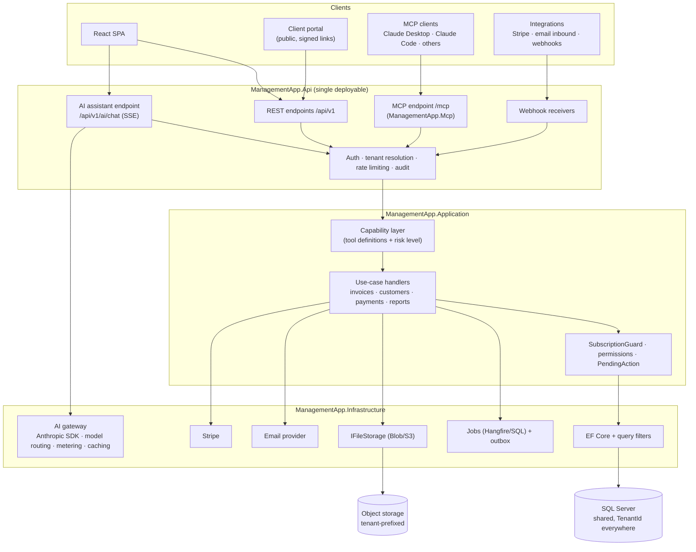
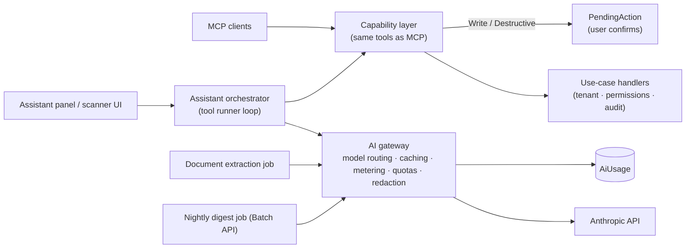
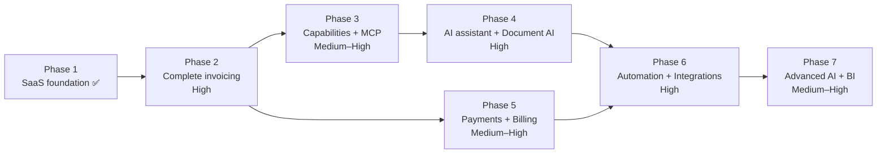

# Product Roadmap & Technical Architecture

> **Status:** proposal, nothing in this document is implemented yet unless marked ✅.
> **Scope:** turning the invoice manager into an AI-native, multi-tenant SaaS for freelancers, small businesses and accounting firms.
> **Supersedes:** the short [`ROADMAP.md`](ROADMAP.md), which remains as the original sketch.

**Contents**

1. [Current architecture assessment](#1-current-architecture-assessment)
2. [Recommended target architecture](#2-recommended-target-architecture)
3. [Phased implementation roadmap](#3-phased-implementation-roadmap)
4. [Prioritized feature backlog](#4-prioritized-feature-backlog)
5. [Database architecture recommendations](#5-database-architecture-recommendations)
6. [AI architecture proposal](#6-ai-architecture-proposal)
7. [MCP architecture proposal](#7-mcp-architecture-proposal)
8. [Security considerations](#8-security-considerations)
9. [Complexity and dependencies](#9-complexity-and-dependencies)
10. [GitHub milestones and issues](#10-github-milestones-and-issues)
11. [Recommended MVP scope](#11-recommended-mvp-scope)
12. [Features to postpone](#12-features-to-postpone)
13. [Product differentiation](#13-product-differentiation)
14. [Technology decisions summary](#14-technology-decisions-summary)

---

## 1. Current architecture assessment

Based on the code on branch `feature/multi-tenancy`.

### 1.1 Stack and structure

| Area | Today |
| --- | --- |
| Backend | .NET 10, ASP.NET Core minimal APIs, Clean Architecture (`Domain` → `Application` → `Infrastructure` → `Api`), one plain handler class per use case, FluentValidation, ProblemDetails, `TimeProvider` |
| Data | EF Core 10 on SQL Server (SQLite in tests), one shared database |
| Auth | ASP.NET Core Identity API endpoints, cookie (SPA) and opaque bearer tokens |
| Frontend | React 19, TypeScript (strict), Vite, Tailwind 4, TanStack Query, React Hook Form + Zod |
| Testing | xUnit v3 + Shouldly, `WebApplicationFactory` over real HTTP, SQLite with the real schema; Vitest + Testing Library. 113 .NET and 30 web tests |
| Delivery | Docker image (API serves the SPA), docker-compose with SQL Server, GitHub Actions CI, Dependabot |

### 1.2 What exists (✅) and can be reused

| Capability | Where | Reuse |
| --- | --- | --- |
| ✅ Multi-tenancy | `ITenantEntity`, global query filters + save guard in `ApplicationDbContext`, `TenantResolutionMiddleware` | Every new entity becomes tenant-safe by implementing `ITenantEntity` |
| ✅ Roles & permissions | `TenantRole`, `Permission` flags, `Policies.Has(...)` | MCP scopes and AI tool permissions map 1:1 onto `Permission` |
| ✅ Super admin, tenants, users, impersonation | `Platform*Handlers`, `AdminEndpoints`, `ImpersonationSession` | Basis for support tooling and platform analytics |
| ✅ Audit log | `IAuditLogger`, `AuditActions`, `AuditLog` | AI and MCP actions are logged through the same logger with a `via` marker |
| ✅ Subscription model | `TenantSubscription`, `SubscriptionPlans`, `PlanFeature`, `SubscriptionGuard` | Add `Ai`, `Mcp`, `DocumentAi` features and usage quotas; connect Stripe later |
| ✅ Tenant settings | `Tenant` + owned settings (numbering, tax label, branding, email, notifications) | Feeds PDF, email and AI tone of voice |
| ✅ Background jobs | `TenantJobRunner`, `BackgroundJobScheduler` | Pattern stays; the hosting mechanism needs hardening (see 1.3) |
| ✅ Notifications abstraction | `INotificationSender` (logging stub) | Swap in a real email provider |
| ✅ Invoice math | `Invoice` totals, status, rounding mirrored in the frontend | Keep as the single source of truth |
| ✅ Test harness | `ApiFactory`, cross-tenant tests | Extend for MCP and AI tools (cross-tenant tool calls must fail) |

### 1.3 What needs improvement before scaling

| Issue | Why it matters at hundreds/thousands of tenants | Fix (phase) |
| --- | --- | --- |
| Invoice list, export and reports **load every invoice of the tenant into memory**; status filtering happens in memory; no pagination | A tenant with 20,000 invoices makes every list request slow and memory-heavy; AI tools that summarise data would do the same | Persist computed totals (`Subtotal`, `Total`, `BalanceDue`), derive status in SQL, paginate (Phase 2) |
| No **customers / products**: "From"/"To" are free text | Prevents customer history, statements, portal, payment prediction, AI lookups | `Customer`, `Product` entities (Phase 2) |
| **Single `AmountPaid` field** | No payment history, no reconciliation, no Stripe | `Payment` entity (Phase 2) |
| **No invoice lifecycle** (draft/sent/void), issued invoices are editable | Legally, issued invoices must be immutable; AI must create drafts only | `InvoiceState` + credit notes (Phase 2) |
| **In-process timer jobs**, no distributed lock | With 2+ API instances every job runs twice (duplicate reminders) | Hangfire on SQL Server, or an outbox + lease table (Phase 2) |
| Notifications only logged | No real product without email | Email provider + outbox (Phase 2) |
| No **rate limiting**, no API versioning, no API tokens | Public API / MCP would be unprotected and unversioned | ASP.NET rate limiter partitioned by tenant/token, `Asp.Versioning`, personal access tokens (Phase 3) |
| Tenant resolution does 2–4 queries per request | Fine now, noticeable at scale | `HybridCache` with tenant-prefixed keys, short TTL (Phase 2) |
| Data Protection keys on a file volume | Multi-instance deployments invalidate each other's cookies | Persist keys to the database or blob storage (Phase 2) |
| Observability = default logging + DB health check | Hard to debug per-tenant issues, no AI cost visibility | OpenTelemetry traces/metrics, tenant id in log scope (Phase 2) |
| Language and time zone stored but unused | Overdue status uses UTC dates; no translations | Tenant time zone for "today", i18n later (Phase 2 / postponed) |

### 1.4 Integrations today

None beyond CSV export and ASP.NET Identity. No payment, email, storage, accounting or AI provider.

### 1.5 UI/UX today

Clean, responsive, light/dark, accessible primitives (`ui.tsx`), lazy-loaded admin area, tenant switcher, impersonation banner. Gaps: no charts, no command palette, no global search, no onboarding checklist, no empty-state guidance for new tenants, settings is one long form, no notifications centre.

### 1.6 AI and MCP opportunity in this codebase

The handler-per-use-case design is the key asset: each handler already enforces validation, tenant scope, permissions (at the endpoint), subscription limits and auditing. **AI tools and MCP tools should call these handlers rather than the database**, so no new security code paths are introduced.

---

## 2. Recommended target architecture

### 2.1 Principles

1. **One capability layer, three front doors.** The web UI, the built-in AI assistant and the MCP server call the same application capabilities.
2. **AI proposes, humans approve.** Anything that changes money, sends something or is irreversible goes through an explicit confirmation step.
3. **Boring infrastructure.** Stay on .NET + SQL Server; add a technology only when a concrete requirement demands it.
4. **Tenant isolation everywhere, including prompts, files, caches, logs and queues.**
5. **Measure AI cost per tenant from day one.**

### 2.2 Target component view

### 2.3 Key decisions

| Decision | Recommendation | Reason |
| --- | --- | --- |
| Deployment | Keep **one deployable** (API + SPA + MCP + jobs) with the option to run job workers as a separate instance of the same image (`--role worker`) | Lowest operational cost; scales horizontally once jobs use Hangfire/SQL |
| MCP placement | **Same host, separate project** `ManagementApp.Mcp` mapped at `/mcp` | Reuses auth, tenant resolution and handlers; can be split out later without code changes |
| AI provider | Anthropic SDK behind **narrow, feature-specific interfaces** (`IAssistantModel`, `IDocumentExtractor`, `ITextGenerator`), not a generic multi-provider framework | Swappable per feature if ever needed, without lowest-common-denominator abstractions |
| Queue | **Hangfire with SQL Server storage** (or an outbox + lease table if Hangfire's licence/complexity is unwanted) | Fits the stack; no RabbitMQ/Kafka/Redis needed for this load |
| Cache | `HybridCache` (in-memory first; Redis only when running several instances) | Built into .NET; tenant-prefixed keys |
| Files | `IFileStorage` → Azure Blob Storage or S3-compatible storage; keys `tenants/{tenantId}/...` | Logos can stay in the DB; documents and PDFs cannot |
| Vector DB / RAG | **Not needed initially.** Financial questions are answered with structured tools over SQL. Document search starts with SQL Server full-text search. Revisit only if semantic search over contracts becomes a paid feature | Avoids a whole extra system and its tenant-isolation risks |
| API versioning | `Asp.Versioning` with `/api/v1` for the public API and MCP-facing contracts; the SPA moves to v1 at the same time | External clients need stability |
| Observability | OpenTelemetry (traces, metrics, logs) with `tenant.id`, `user.id`, `via` attributes; export to Azure Monitor / Grafana | Per-tenant debugging and AI cost dashboards |

---

## 3. Phased implementation roadmap

### Recommended order (and why it differs slightly from the original proposal)

| # | Phase | Change vs. original | Rationale |
| --- | --- | --- | --- |
| 1 | SaaS Foundation | ✅ done | Implemented on `feature/multi-tenancy` |
| 2 | Complete Invoice Management | unchanged | Everything after depends on customers, payments, drafts, PDF, email |
| 3 | **Capability layer + MCP** | moved **before** the AI assistant | The tool layer is the foundation of both. MCP ships value with **zero AI cost to us** (the customer's own AI client pays for inference) and validates the tool design before we build a chat UI on top |
| 4 | AI Assistant & Document AI | merged | Chat, natural-language queries, invoice drafting and the invoice scanner share the AI gateway, metering and confirmation flow |
| 5 | Payments & Commercialization | merged and moved earlier | Stripe is used both for customers paying invoices and for tenants paying us; doing them together halves the integration work and starts revenue earlier |
| 6 | Automation & Integrations | unchanged | Needs payments, email and documents in place |
| 7 | Advanced AI & Business Intelligence | unchanged | Needs months of payment history to be accurate |

Each phase lists **Essential** (must ship) and **Nice-to-have** (can slip to a later phase).

---

### Phase 1: SaaS Foundation ✅

**Objective:** multiple isolated companies, super admin, impersonation, audit. **Status:** implemented and tested (see README → Multi-tenancy).

**Remaining hardening (carry into Phase 2):** rate limiting, cached tenant resolution, shared Data Protection key store, distributed job locking, tenant time zone for overdue calculation.

---

### Phase 2: Complete Invoice Management

**Objective:** a commercially credible invoicing product that a small business can run on daily, and the data model that AI and MCP need.

**Features**

| Feature | Essential / Nice |
| --- | --- |
| Customers (CRUD, contact data, tax number, default currency and terms, notes) | Essential |
| Products & services catalogue (price, unit, tax rate) | Essential |
| Invoice lifecycle: `Draft → Issued (Sent) → Paid / Partially paid / Overdue → Void`; credit notes instead of editing issued invoices | Essential |
| Concurrency-safe invoice numbering per tenant (sequence table) | Essential |
| Payments: multiple partial payments, method, reference, date; payment history | Essential |
| PDF generation with tenant branding (logo, colour, footer, tax label) | Essential |
| Email delivery: send invoice (PDF attached), reminders, invitations; per-tenant sender name and reply-to; delivery status | Essential |
| Persisted totals, SQL-side status filtering, pagination, sorting, server-side search | Essential |
| Tenant time zone used for "today" / overdue | Essential |
| Hangfire (or outbox + lease) for jobs and emails; distributed-safe recurring jobs | Essential |
| Recurring invoices (schedule, interval, next run, auto-send or draft) | Essential |
| Client portal v1: signed public link per invoice → view, download PDF, see payment status | Essential |
| Quotes/estimates → convert to invoice | Nice |
| Multi-currency: per-invoice currency already exists; add exchange-rate snapshot per invoice and base-currency reporting | Nice (FX reporting) |
| Customer statements (PDF of open items per customer) | Nice |
| Global search / command palette (Ctrl+K) | Nice |

**Database changes:** `Customers`, `CustomerContacts`, `Products`, `Payments`, `InvoiceNumberSequences`, `RecurringInvoiceSchedules`, `EmailMessages` (outbox + status), `PortalLinks`, `ExchangeRates` (nice); `Invoices` gains `CustomerId`, `State`, `IssuedAt`, `VoidedAt`, `Subtotal`, `Total`, `BalanceDue`, `BaseCurrencyTotal`, `PdfStorageKey`; `AmountPaid` migrated into `Payments`. All tenant tables implement `ITenantEntity` and get `(TenantId, …)` indexes.

**Backend changes:** customer/product/payment handlers; invoice state machine in the domain; `IPdfRenderer` (QuestPDF); `IFileStorage`; email provider adapter; Hangfire setup with tenant-aware job filter (sets `TenantContext` per job); portal endpoints with signed, expiring tokens; pagination contract (`PagedResult<T>` already exists).

**Frontend changes:** customer and product pages; customer picker in the invoice editor (with "create on the fly"); invoice state badges and actions (Issue, Send, Void, Record payment); payment history panel; recurring schedule editor; email preview; portal page (public route, no app chrome).

**Integrations:** email provider (Postmark/Resend/SendGrid or SMTP), object storage, QuestPDF (check its Community licence revenue threshold).

**Dependencies:** Phase 1.

**Complexity:** **High** (largest data-model change; migration of existing invoices to customers needs care: create customers from distinct "To" blocks per tenant).

**Acceptance criteria**
- A user can create a customer, issue an invoice from catalogue items, email it as a branded PDF, and record two partial payments; the invoice becomes Paid.
- Issued invoices cannot be edited, only voided or credited; every transition is audited.
- Listing 50,000 invoices in one tenant returns page 1 in under 300 ms (indexed, no in-memory loading).
- Recurring invoices fire exactly once per period with two API instances running.
- A portal link shows only that invoice, expires, and cannot be enumerated.
- All new entities pass the cross-tenant test suite.

---

### Phase 3: Capability layer + MCP server

**Objective:** expose the product to AI clients securely, and create the tool layer the built-in assistant will reuse.

**Features**

| Feature | Essential / Nice |
| --- | --- |
| Capability layer: typed tool definitions over existing handlers, each with JSON schema, required `Permission`, risk level (`Read`, `Draft`, `Write`, `Destructive`) and audit action | Essential |
| Personal access tokens (per user + tenant, scoped permissions, expiry, revocation, last used) | Essential |
| Public API v1 (`Asp.Versioning`), OpenAPI document, rate limiting per tenant and per token | Essential |
| MCP server at `/mcp` (Streamable HTTP) with read tools, resources and prompts | Essential |
| MCP draft/write tools with confirmation | Essential |
| OAuth 2.1 authorization server for MCP (so Claude Desktop connects without pasting tokens) | Nice in this phase, essential before marketing MCP widely |
| "Connect your AI" page: copy-paste config for Claude Desktop / Claude Code, token management, usage log | Essential |
| Outgoing webhooks (`invoice.issued`, `invoice.paid`, ...) | Nice |

**Database changes:** `ApiTokens` (hash, prefix, scopes, tenant, user, expiry, last used), `PendingActions` (proposed write awaiting confirmation), `WebhookSubscriptions` / `WebhookDeliveries` (nice), OAuth tables if using OpenIddict.

**Backend changes:** `ManagementApp.Mcp` project (official C# MCP SDK); token authentication handler that sets the same claims + tenant context as a session; rate limiter partitioned by token/tenant; capability registry; `PendingAction` workflow; audit `via: mcp`, client name, token id.

**Frontend changes:** "Developer & AI" settings section: tokens, scopes, connection instructions, recent MCP activity; pending-actions inbox ("Claude wants to record a payment of €500 on INV-0042 — Approve / Reject").

**Integrations:** MCP C# SDK; optionally OpenIddict for OAuth 2.1.

**Dependencies:** Phase 2 (customers, payments, drafts, send).

**Complexity:** **Medium** (read tools + PAT) → **High** with OAuth 2.1.

**Acceptance criteria**
- Claude Desktop, configured with a token, can answer "Which invoices are overdue by more than 15 days?" from live data.
- A token scoped to tenant A can never read tenant B data, even when passing B's IDs (automated tests per tool).
- A token without `InvoicesEdit` cannot call write tools; the error is a normal MCP tool error, not a crash.
- Every MCP call is in the audit log with token id and client name; tokens can be revoked instantly.
- Destructive operations (void, delete, send) are either not exposed or require an approved `PendingAction`.

---

### Phase 4: AI Assistant & Document AI

**Objective:** make AI a central, trustworthy part of daily work.

**Features**

| Feature | Essential / Nice |
| --- | --- |
| AI gateway: Anthropic SDK, model routing, prompt caching, usage metering per tenant, quotas per plan, timeouts and fallbacks, kill switch per tenant and globally | Essential |
| Assistant chat panel (streaming), grounded in Phase 3 tools: natural-language questions, tables in answers, links to records | Essential |
| Natural-language invoice drafting ("10 hours of consulting for ABC at €50/h") → prefilled draft for review | Essential |
| Smart Invoice Scanner: upload PDF/image of a supplier invoice or receipt → structured expense/purchase draft, duplicate check, supplier matching, VAT validation | Essential |
| Expenses & suppliers (needed by the scanner) | Essential |
| Reminder writer (tone by days overdue and customer history), always reviewed before sending | Essential |
| AI-generated monthly report (narrative + figures, exported to PDF) | Nice |
| "Invoice QA" before issuing: missing tax number, unusual amount, wrong currency for customer, duplicate | Nice |
| Product/line-item suggestions from past invoices for the customer | Nice |
| Conversation history per user, deletable | Essential |

**Database changes:** `AiConversations`, `AiMessages` (tenant + user owned, retention policy), `AiUsage` (tenant, user, feature, model, input/output/cache tokens, cost), `Documents` (storage key, hash, type, status), `DocumentExtractions` (JSON result, confidence, reviewer), `Suppliers`, `Expenses`, `ExpenseCategories`.

**Backend changes:** `Infrastructure/Ai` gateway; assistant orchestration using the SDK tool runner with the capability layer as tools; SSE endpoint; extraction pipeline as a background job (upload → virus scan → extract with structured output → validate → duplicate check → draft); `SubscriptionGuard` checks `Ai` / `DocumentAi` features and monthly allowance.

**Frontend changes:** assistant side panel (available on every page, context-aware: "this invoice"); result tables with "open" links; draft review screens with extracted fields highlighted and confidence; drag-and-drop upload; usage meter in settings.

**Integrations:** Anthropic API (Claude Opus 5.5 for the assistant; Claude Haiku 5.5 for bulk extraction/classification, see §6.4); antivirus scanning for uploads (e.g. ClamAV container or cloud scanner).

**Dependencies:** Phase 3 (tools, PendingAction), Phase 2 (storage, customers).

**Complexity:** **High**.

**Acceptance criteria**
- The five example questions in the brief are answered correctly on a seeded dataset (automated eval set, ≥ 95% pass).
- Drafting from natural language never saves or sends without the user's confirmation.
- Scanning a typical one-page supplier invoice produces a draft in under 15 s with supplier, number, dates, totals, VAT and lines; duplicates are flagged.
- AI usage and cost are visible per tenant to platform admins and per month to tenant admins; quotas are enforced.
- Prompt-injection tests (malicious text in invoice notes / uploaded PDFs) cannot trigger writes.

---

### Phase 5: Payments & Commercialization

**Objective:** customers pay invoices online, tenants pay us.

**Features**

| Feature | Essential / Nice |
| --- | --- |
| Stripe Connect (each tenant connects its own Stripe account) → "Pay now" on portal and email | Essential |
| Stripe webhooks → `Payment` records, idempotent, signature-verified | Essential |
| Stripe Billing for our subscriptions: plans, monthly/yearly, trials, upgrades/downgrades, dunning, invoices to tenants | Essential |
| Usage-based add-ons (AI questions, scanned documents) reported to Stripe | Nice |
| Self-service plan management page for tenant admins | Essential |
| Platform analytics: MRR, churn, trial conversion, AI cost vs. revenue per tenant | Essential |
| PayPal | Nice (postpone unless customers ask) |
| Bank transfer tracking with reference matching (manual import of CSV / CAMT.053) | Nice |

**Database changes:** `PaymentProviderAccounts` (tenant ↔ Stripe account), `PaymentIntents`, `ProcessedWebhookEvents` (idempotency), `TenantSubscription` gains `StripeCustomerId`, `StripeSubscriptionId`.

**Backend / frontend:** Stripe adapters, webhook endpoints, billing portal redirect, plan page, admin revenue dashboard.

**Dependencies:** Phase 2 (payments, portal). Can run **in parallel with Phase 4**.

**Complexity:** **Medium–High**.

**Acceptance criteria**
- A customer pays an invoice through the portal; within seconds the invoice is Paid with a Stripe payment record.
- Duplicate webhook deliveries never create duplicate payments.
- A tenant can upgrade from Trial to Starter, and limits change immediately; failed renewal moves the tenant to PastDue → read-only after grace period.

---

### Phase 6: Automation & Integrations

**Objective:** remove repetitive work.

| Feature | Essential / Nice |
| --- | --- |
| Rules engine v1: trigger (invoice issued / overdue N days / payment received / document uploaded) → conditions → actions (email, notify user, assign, webhook, create task) | Essential |
| Email-to-expense inbox: unique forwarding address per tenant (`acme-1a2b@in.yourapp.com`), attachments go through the Phase 4 scanner | Essential |
| Automatic payment reconciliation from bank statement import (CSV / CAMT.053), AI-assisted matching for ambiguous cases | Essential |
| Accounting exports (CSV/Excel layouts for common accounting packages; DATEV/QuickBooks/Xero formats on demand) | Essential |
| Gmail / Microsoft 365 mailbox connection (OAuth) for invoice detection | Nice (forwarding address covers most needs) |
| Two-way accounting sync (Xero/QuickBooks APIs) | Nice |
| Visual workflow builder UI | Nice (start with a form-based rule editor) |
| Zapier/Make app built on webhooks + API v1 | Nice |

**Database changes:** `AutomationRules`, `AutomationRuns`, `InboundEmails`, `BankStatements`, `BankTransactions`, `ReconciliationMatches`, `IntegrationConnections` (encrypted credentials per tenant).

**Dependencies:** Phases 2, 4, 5.

**Complexity:** **High**.

**Acceptance criteria:** a forwarded supplier invoice becomes a reviewed expense draft without manual typing; a bank statement import auto-matches ≥ 80% of payments on the sample dataset; rules run once per event and are fully audited.

---

### Phase 7: Advanced AI & Business Intelligence

**Objective:** proactive insights that justify a premium plan.

| Feature | Approach | Essential / Nice |
| --- | --- | --- |
| Cash-flow forecast (30/60/90 days) | Deterministic model from due dates × per-customer payment-delay distribution + recurring invoices + expected expenses; AI only writes the narrative | Essential |
| Customer payment risk score | Statistical features (average days late, trend, partial payments, amount vs. history); explainable score, no LLM needed | Essential |
| Anomaly detection (duplicate/unusual expenses, unusual invoice amounts) | Rules + statistics first, LLM to explain | Essential |
| Daily/weekly AI business digest ("Business Copilot") | Nightly batch job using the Batch API (50% cheaper), delivered by email and in-app | Essential |
| Intelligent notifications (only what matters, with suggested action) | Ranking over the signals above | Nice |
| Recommendations ("offer a 2% early-payment discount to X", "follow up with Y by phone") | LLM over computed signals, tied to one-click actions | Nice |

**Dependencies:** Phases 2–6 and ~3–6 months of real payment data.

**Complexity:** **Medium–High**.

**Acceptance criteria:** forecast error is reported back to the user (predicted vs. actual) and within ±15% on the reference dataset; every insight links to the records it is based on.

---

## 4. Prioritized feature backlog

Priority: **P0** = MVP, **P1** = next, **P2** = later, **P3** = only on demand. Value/effort on a 1–5 scale.

| # | Feature | Phase | Priority | Value | Effort | Monetization |
| --- | --- | --- | --- | --- | --- | --- |
| 1 | Customers & products | 2 | P0 | 5 | 3 | Core |
| 2 | Invoice lifecycle + credit notes | 2 | P0 | 5 | 3 | Core |
| 3 | Payments entity + history | 2 | P0 | 5 | 2 | Core |
| 4 | PDF generation | 2 | P0 | 5 | 2 | Core |
| 5 | Email delivery + outbox | 2 | P0 | 5 | 2 | Core |
| 6 | Persisted totals + pagination | 2 | P0 | 4 | 2 | Scale |
| 7 | Job infrastructure (Hangfire/outbox) | 2 | P0 | 4 | 2 | Reliability |
| 8 | Recurring invoices | 2 | P0 | 4 | 2 | Starter+ |
| 9 | Client portal v1 | 2 | P0 | 4 | 3 | Starter+ |
| 10 | Personal access tokens + API v1 + rate limiting | 3 | P0 | 4 | 2 | Pro |
| 11 | MCP server (read tools) | 3 | P0 | 5 | 2 | Pro, marketing hook |
| 12 | MCP draft/write tools + PendingAction | 3 | P0 | 5 | 3 | Pro |
| 13 | AI gateway + metering + quotas | 4 | P0 | 4 | 3 | Enables AI plans |
| 14 | AI assistant (questions + drafting) | 4 | P0 | 5 | 3 | Pro / AI add-on |
| 15 | Smart Invoice Scanner + expenses | 4 | P0 | 5 | 4 | Pro / per-document |
| 16 | Stripe payments on invoices | 5 | P0 | 5 | 3 | Transaction value |
| 17 | Stripe Billing for subscriptions | 5 | P0 | 5 | 3 | Revenue |
| 18 | Reminder writer + automatic dunning | 4/6 | P1 | 5 | 2 | Pro |
| 19 | OAuth 2.1 for MCP | 3 | P1 | 4 | 4 | Pro |
| 20 | Email-to-expense inbox | 6 | P1 | 5 | 3 | Pro |
| 21 | Bank statement import + reconciliation | 6 | P1 | 5 | 4 | Pro |
| 22 | Accountant (multi-company) workspace | 6 | P1 | 5 | 3 | Accountant plan |
| 23 | Rules engine v1 | 6 | P1 | 4 | 4 | Pro |
| 24 | Accounting exports | 6 | P1 | 4 | 2 | Starter+ |
| 25 | Cash-flow forecast | 7 | P1 | 5 | 3 | Pro |
| 26 | Payment risk score | 7 | P1 | 4 | 2 | Pro |
| 27 | Business digest (batch) | 7 | P1 | 4 | 2 | Pro |
| 28 | E-invoicing (Peppol / EN 16931 / ZUGFeRD / XRechnung) | 6 | P1 (EU) | 5 | 4 | Compliance add-on |
| 29 | Quotes/estimates | 2 | P2 | 3 | 2 | Core |
| 30 | Multi-currency base reporting + FX | 2 | P2 | 3 | 2 | Pro |
| 31 | Outgoing webhooks | 3 | P2 | 3 | 2 | Pro |
| 32 | Anomaly detection | 7 | P2 | 4 | 3 | Pro |
| 33 | Gmail/M365 mailbox connection | 6 | P2 | 3 | 4 | Pro |
| 34 | Two-way accounting sync | 6 | P2 | 4 | 5 | Enterprise |
| 35 | Visual workflow builder | 6 | P2 | 3 | 5 | Enterprise |
| 36 | PayPal | 5 | P3 | 2 | 3 | — |
| 37 | Voice assistant | — | P3 | 2 | 3 | — |
| 38 | API marketplace | — | P3 | 2 | 5 | — |
| 39 | Vector search over documents | — | P3 | 2 | 4 | — |

---

## 5. Database architecture recommendations

1. **Keep the shared database with `TenantId` (pool model).** It already works, is tested, and is the cheapest to run for thousands of small tenants.
2. **Add SQL Server Row-Level Security as defence in depth** (Phase 2/3): a security policy filtering on `TenantId = SESSION_CONTEXT('TenantId')`, set by a `DbConnectionInterceptor` from `ITenantContext`. A bug in an EF query (or raw SQL) then still cannot leak data. Platform-admin and job connections set an explicit bypass flag that is audited.
3. **Prepare for the silo option** (Enterprise only, later): introduce a `TenantDatabase` map (tenant → connection string) behind `IDbContextFactory`; default all tenants to the shared database. This allows moving a large or regulated tenant to its own database without code changes.
4. **Indexes lead with `TenantId`** on every tenant table: `(TenantId, State, DueDate)`, `(TenantId, CustomerId, IssueDate)`, `(TenantId, Created)` for monthly limits, `(TenantId, Number)` unique.
5. **Persist computed values** that queries filter or sort on (`Total`, `BalanceDue`, `Subtotal`, `TaxTotal`), recalculated in the domain on every change; keep the domain methods as the single source of truth and assert equality in tests.
6. **Issued financial documents are immutable.** Corrections via credit notes; `Void` instead of delete; soft delete only for drafts and master data (customers, products) with `DeletedAt`.
7. **Invoice numbering:** a `InvoiceNumberSequences` row per tenant (and per series/year if configured), incremented with `UPDATE ... OUTPUT` inside the issue transaction; numbers are assigned on **issue**, not on draft creation (legal gap-free requirement in many countries).
8. **Money:** `decimal(18,2)` amounts plus currency on each document; `decimal(18,6)` exchange rate snapshot and `BaseCurrencyTotal` when multi-currency reporting is added.
9. **Audit log growth:** partition `AuditLogs` by month (or archive to blob storage after 13 months), keep indexes `(TenantId, Timestamp)`; consider a separate database/schema for audit and AI usage so they don't bloat the OLTP database.
10. **Optimistic concurrency** (`rowversion`) on invoices, payments and customers to prevent lost updates from parallel UI/AI/MCP edits.
11. **Encrypted secrets** (`IntegrationConnections`, webhook secrets) with ASP.NET Data Protection or Azure Key Vault; never stored in plain text.

### New entities by phase

| Phase | Entities (all `ITenantEntity` unless noted) |
| --- | --- |
| 2 | Customer, CustomerContact, Product, Payment, InvoiceNumberSequence, CreditNote, RecurringInvoiceSchedule, EmailMessage, PortalLink, ExchangeRate *(global)* |
| 3 | ApiToken, PendingAction, WebhookSubscription, WebhookDelivery, OAuth client/token tables *(global, tenant-bound tokens)* |
| 4 | AiConversation, AiMessage, AiUsage, Document, DocumentExtraction, Supplier, Expense, ExpenseCategory |
| 5 | PaymentProviderAccount, PaymentIntent, ProcessedWebhookEvent *(global)* |
| 6 | AutomationRule, AutomationRun, InboundEmail, BankStatement, BankTransaction, ReconciliationMatch, IntegrationConnection |
| 7 | CustomerRiskScore, CashFlowForecast, Insight |

---

## 6. AI architecture proposal

### 6.1 Building blocks

| Component | Responsibility |
| --- | --- |
| **Capability layer** (`Application/Capabilities`) | Tool name, description, JSON schema (strict), required permission, risk level, handler invocation, result shaping (compact JSON, row limits) |
| **AI gateway** (`Infrastructure/Ai`) | The only place that talks to the provider: Anthropic C# SDK, model per feature, prompt caching, retries, timeouts, refusal handling, usage metering (tokens + cost per tenant/user/feature), quotas via `SubscriptionGuard`, global and per-tenant kill switch |
| **Assistant orchestrator** | Builds the system prompt (company profile, currency, today in tenant time zone, permissions), runs the tool loop, streams to the UI via SSE, persists the conversation |
| **PendingAction** | Any `Write`/`Destructive` tool call becomes a proposal the user approves in the UI (or via MCP confirmation); execution re-checks permissions at approval time |
| **Extraction pipeline** | Background job: file → scan → structured-output extraction → deterministic validation (sums, VAT, dates) → duplicate check → draft for review |
| **Evaluation set** | Versioned set of questions/documents with expected answers, run in CI on prompt or model changes |

### 6.2 Provider abstraction

Narrow interfaces per capability, not a generic "LLM client":

- `IAssistantModel.StreamAsync(conversation, tools)`
- `IDocumentExtractor.ExtractAsync<T>(file, schema)`
- `ITextGenerator.GenerateAsync(template, data)` (reminders, report narratives)

Implementations use the official Anthropic C# SDK. Switching one feature to another provider later means one new implementation, not a framework migration.

### 6.3 Patterns that keep AI safe and accurate

- **Grounding through tools, not RAG:** numbers always come from handlers; the model never computes totals itself. Answers include links to the records used.
- **Structured outputs** for extraction and drafting (schema-validated JSON), then deterministic validation in .NET.
- **Untrusted content is data:** invoice notes, customer names, OCR text and emails are wrapped as tool results/documents, never as instructions; tool access is limited to the user's permissions; writes always need confirmation.
- **Minimal data in prompts:** send only what a tool returns, row-limited; no full-database dumps; mask bank account numbers where not needed.
- **Tenant-scoped everything:** conversations, usage, cache keys and documents all carry `TenantId`.

### 6.4 Model selection and cost management

Prices from Anthropic's current price list (per million tokens): **Claude Opus 5.5** $4 in / $20 out; **Claude Sonnet 5.5** $2 / $10; **Claude Haiku 5.5** $0.10 / $0.50 (≤100K-token prompts). Batch API = 50% discount; cached prompt reads are much cheaper than fresh input.

| Workload | Model | Notes |
| --- | --- | --- |
| Assistant (questions, drafting, reasoning over tool results) | Claude Opus 5.5 at `low`/`medium` effort | Best tool-use reliability; lower effort keeps cost down. Measure before introducing cheaper routing |
| Document extraction, classification, duplicate explanation | Claude Haiku 5.5 | High volume, structured output |
| Nightly digests and monthly reports | Claude Opus 5.5 via Batch API | Not latency-sensitive → 50% cheaper |
| Reminder emails | Claude Haiku 5.5 (upgrade if quality is lacking) | Short outputs |

**Rough cost estimates** (to validate with real measurements):

| Action | Assumption | Approx. cost |
| --- | --- | --- |
| One assistant question | ~8K input (system + tools, mostly cached) + 2 tool rounds + ~1K output on Opus 5.5 | **$0.03–0.08** |
| Scan one 1–2 page invoice | ~4K input + ~800 output on Haiku 5.5 | **< $0.001** |
| Nightly digest per tenant | ~10K input + 1K output, Opus 5.5 batch | **≈ $0.03/day ≈ $1/month** |

**Cost controls:** prompt caching of system prompt + tool definitions; compact tool results; per-plan monthly allowances (e.g. Trial 50 questions, Pro 1,000, overage billed); per-tenant daily spend cap and alert; `AiUsage` dashboard for platform admins; MCP usage costs us nothing in inference (the client's AI pays).

### 6.5 Privacy and compliance

- Clear AI data-processing notice per tenant; AI can be disabled per tenant (and is off by default for Enterprise until enabled by an admin).
- Data-processing agreement with the AI provider; choose data-residency options where required.
- Conversation retention (e.g. 90 days, configurable), user-deletable.

---

## 7. MCP architecture proposal

### 7.1 Placement

**Part of the existing backend, separate project** (`ManagementApp.Mcp`, mapped at `/mcp` in the API host, Streamable HTTP transport via the official C# MCP SDK).

| Option | Pros | Cons | Verdict |
| --- | --- | --- | --- |
| Inside the API host (separate project) | Reuses auth, tenant resolution, handlers, audit; one deployment | Shares scaling with the API | **Recommended now** |
| Separate service calling REST API v1 | Independent scaling; dog-foods the public API | Duplicated auth plumbing, extra hop, two deployments | Later, if MCP traffic justifies it |
| Local stdio server distributed to users | Works offline with any client | Needs distribution and updates; still needs the API | Not needed: remote MCP is supported by Claude Desktop/Code |

### 7.2 Authentication and tenant context

1. **Step 1 – Personal access tokens:** `Authorization: Bearer mgmt_pat_…`; token bound to one user + one tenant + selected permissions (never more than the user has). The token handler sets the same claims as a session, so `TenantResolutionMiddleware`, policies and `ITenantContext` work unchanged. The tenant can **never** be selected through tool arguments.
2. **Step 2 – OAuth 2.1** (authorization code + PKCE, dynamic client registration, as the MCP specification describes), implemented with OpenIddict in the same host. The consent screen shows the company and the permissions being granted.
3. Tokens are revocable instantly, show "last used", and are audited.

### 7.3 Tools

| Tool | Risk | Permission |
| --- | --- | --- |
| `list_invoices` (filters: status, customer, dates, text; paginated) | Read | InvoicesView |
| `get_invoice` | Read | InvoicesView |
| `find_overdue_invoices` (min days overdue) | Read | InvoicesView |
| `get_upcoming_due_dates` (next N days) | Read | InvoicesView |
| `list_customers` / `get_customer` (incl. payment history summary) | Read | InvoicesView |
| `list_payments` | Read | InvoicesView |
| `get_financial_statistics` (period, currency) | Read | ReportsView |
| `generate_financial_report` (period → structured report) | Read | ReportsView |
| `create_customer` | Write (low risk) | InvoicesCreate |
| `create_invoice_draft` / `update_invoice_draft` | Draft | InvoicesCreate / InvoicesEdit |
| `issue_and_send_invoice` | Destructive (external effect) | InvoicesEdit + confirmation |
| `register_payment` | Write (money) | InvoicesEdit + confirmation |
| `void_invoice` | Destructive | InvoicesDelete + confirmation |

**Safeguards for Write/Destructive tools:** two-step pattern: the tool returns a `pending_action_id` and a human-readable summary; execution happens only after approval in the web app (or via an explicit `confirm_action` call that requires a short-lived confirmation code shown in the UI). Idempotency keys on writes. No hard-delete tools at all.

### 7.4 Resources and prompts

| Resources | URI |
| --- | --- |
| Company profile, tax configuration, invoice settings | `company://profile`, `company://tax`, `company://invoice-settings` |
| Invoice | `invoice://{id}` |
| Customer | `customer://{id}` |
| Products & services | `catalog://products` |
| Financial summary | `finance://summary/{period}` |

| Prompts | What it sets up |
| --- | --- |
| `monthly_financial_report` | Period → uses statistics + report tools, outputs narrative + tables |
| `analyze_unpaid_invoices` | Overdue analysis grouped by customer and age bucket |
| `review_customer_payment_history` | Customer → history, average delay, recommendation |
| `prepare_payment_reminders` | Drafts reminders for overdue invoices (as pending actions) |
| `analyze_business_performance` | Period-over-period comparison |

### 7.5 Operations

- Rate limits per token and per tenant (ASP.NET rate limiter); `Mcp` plan feature in `SubscriptionGuard`.
- Audit: `via: mcp`, tool name, arguments hash, token id, client name/version, result status.
- Observability: OpenTelemetry span per tool call with `tenant.id`.
- Contract tests: every tool has a cross-tenant test and a missing-permission test.

---

## 8. Security considerations

| Area | Measures |
| --- | --- |
| Tenant isolation | Existing filters + save guard; add SQL Server RLS; cross-tenant tests for every endpoint and every MCP/AI tool; tenant-prefixed cache keys, file paths and job payloads |
| Authentication | MFA (TOTP) for tenant admins and mandatory for platform admins; SSO (OIDC/SAML) for Enterprise; PATs hashed with prefix display; OAuth 2.1 for MCP |
| Authorization | Permission per endpoint/tool; PendingAction re-checks permissions at approval time; impersonation already restricted (no admin area, no account changes) |
| AI-specific | Prompt injection: untrusted content as data, least-privilege tools, confirmation for writes, no tool can send data to arbitrary URLs; output validation; per-tenant kill switch; no secrets in prompts |
| Files | Content-type sniffing (as done for logos), size limits, antivirus scan, private storage with short-lived signed URLs, no SVG/HTML rendering |
| Webhooks in | Signature verification (Stripe, email provider), idempotency table, replay window |
| Webhooks out | HMAC-signed payloads, per-subscription secret, SSRF protection (block private IP ranges) |
| Abuse & DoS | Rate limiting per IP/user/tenant/token, request size limits, AI quotas and daily spend caps |
| Data protection | Encryption at rest (TDE), secrets in Key Vault, Data Protection keys in a shared store, GDPR export/delete per tenant, retention policies for AI conversations and audit logs |
| Financial integrity | Immutable issued invoices, gap-free numbering, rowversion concurrency, every money change audited with before/after |
| Supply chain | Dependabot (exists), `dotnet list package --vulnerable` and `npm audit` in CI, pinned container images |

---

## 9. Complexity and dependencies

| Phase | Complexity | Main risks | Rough size (1–2 devs) |
| --- | --- | --- | --- |
| 2 | High | Data migration to customers/payments; invoice immutability rules | 6–8 weeks |
| 3 | Medium (PAT) / High (OAuth) | Tool design granularity; OAuth edge cases | 3–5 weeks |
| 4 | High | Extraction accuracy; AI cost; prompt injection | 6–8 weeks |
| 5 | Medium–High | Webhook idempotency; billing edge cases (proration, dunning) | 4–6 weeks |
| 6 | High | Bank formats; email deliverability; rules engine scope creep | 8–10 weeks |
| 7 | Medium–High | Needs historical data; explainability | 4–6 weeks |

Phases 4 and 5 can run in parallel once Phase 3 is done.

---

## 10. GitHub milestones and issues

Suggested labels: `phase:2`…`phase:7`, `area:backend`, `area:frontend`, `area:db`, `area:ai`, `area:mcp`, `area:security`, `type:feature`, `type:chore`, `priority:P0`…`P3`, `good-first-issue`.

### Milestone M2 – Complete Invoice Management

- [x] Persist invoice totals and filter/sort/paginate in SQL `area:db` `P0`
- [x] Tenant time zone for "today" and overdue status `area:backend` `P0`
- [x] Customer entity, CRUD API and pages `area:backend` `area:frontend` `P0`
- [x] Migrate existing invoice "To" text into customers `area:db` `P0`
- [x] Product & service catalogue `P0`
- [x] Invoice lifecycle (Draft/Issued/Void) with domain state machine `P0`
- [ ] Gap-free numbering assigned on issue (sequence table) `area:db` `P0`
- [ ] Credit notes `P1`
- [ ] Payment entity, record/delete payment, migrate `AmountPaid` `P0`
- [ ] `IFileStorage` with Blob/S3 implementation and tenant-prefixed keys `P0`
- [ ] PDF rendering with tenant branding (QuestPDF) `P0`
- [ ] Email provider adapter + `EmailMessages` outbox + delivery status `P0`
- [ ] "Send invoice" flow with preview `area:frontend` `P0`
- [ ] Hangfire on SQL Server with tenant-aware job filter (replace timer) `P0`
- [ ] Recurring invoice schedules `P0`
- [ ] Client portal v1 (signed links: view, PDF, status) `P0`
- [ ] Cache tenant resolution with `HybridCache` `P1`
- [ ] Shared Data Protection key store `area:security` `P0`
- [ ] OpenTelemetry tracing + tenant id in logs `P1`
- [ ] Quotes/estimates `P2`
- [ ] Exchange-rate snapshot + base currency reporting `P2`

### Milestone M3 – Capabilities & MCP

- [ ] Capability layer (tool definitions, schemas, risk levels, permission mapping) `area:backend` `P0`
- [ ] Personal access tokens (create, scope, revoke, last used) `area:security` `P0`
- [ ] API versioning `/api/v1` + OpenAPI publishing `P0`
- [ ] Rate limiting per tenant/token/IP `area:security` `P0`
- [ ] `ManagementApp.Mcp` project with Streamable HTTP endpoint `area:mcp` `P0`
- [ ] MCP read tools (invoices, customers, payments, overdue, upcoming, statistics) `area:mcp` `P0`
- [ ] MCP resources and prompts `area:mcp` `P1`
- [ ] PendingAction workflow + approvals inbox UI `P0`
- [ ] MCP write tools (draft, create customer, register payment, send, void) via PendingAction `area:mcp` `P0`
- [ ] Cross-tenant and permission tests for every tool `area:security` `P0`
- [ ] "Connect your AI" settings page with Claude Desktop/Code instructions `area:frontend` `P0`
- [ ] OAuth 2.1 authorization server (OpenIddict) for MCP `area:security` `P1`
- [ ] Outgoing webhooks `P2`

### Milestone M4 – AI Assistant & Document AI

- [ ] AI gateway (Anthropic C# SDK, model per feature, caching, retries, kill switch) `area:ai` `P0`
- [ ] `AiUsage` metering + plan quotas in `SubscriptionGuard` `area:ai` `P0`
- [ ] Assistant orchestrator using capability tools + SSE endpoint `area:ai` `P0`
- [ ] Assistant side panel UI with tables, links, history `area:frontend` `P0`
- [ ] Natural-language invoice drafting → draft review screen `P0`
- [ ] Suppliers, expenses and categories `area:backend` `P0`
- [ ] Document upload, antivirus scan, storage `area:security` `P0`
- [ ] Extraction pipeline (structured output → validation → duplicate check → draft) `area:ai` `P0`
- [ ] Extraction review UI with confidence highlighting `area:frontend` `P0`
- [ ] Reminder writer `area:ai` `P1`
- [ ] AI eval set in CI (questions + documents) `area:ai` `P0`
- [ ] Prompt-injection test suite `area:security` `P0`
- [ ] AI usage dashboard (tenant + platform) `P1`
- [ ] Invoice QA before issuing `P2`

### Milestone M5 – Payments & Billing

- [ ] Stripe Connect onboarding per tenant `P0`
- [ ] "Pay now" on portal and email `P0`
- [ ] Stripe webhook receiver with idempotency `area:security` `P0`
- [ ] Stripe Billing for tenant subscriptions + plan page `P0`
- [ ] Grace period and read-only on failed renewal `P0`
- [ ] Platform revenue analytics (MRR, churn, trial conversion, AI cost) `P1`
- [ ] Usage-based AI add-on billing `P2`

### Milestone M6 – Automation & Integrations

- [ ] Inbound email address per tenant → document pipeline `P1`
- [ ] Bank statement import (CSV, CAMT.053) `P1`
- [ ] Reconciliation engine (rules + AI for ambiguous matches) `P1`
- [ ] Rules engine v1 (triggers, conditions, actions) + form-based editor `P1`
- [ ] Automatic dunning sequences `P1`
- [ ] Accounting export formats `P1`
- [ ] Accountant multi-company workspace `P1`
- [ ] E-invoicing (EN 16931 / Peppol) `P1`
- [ ] Gmail / Microsoft 365 connection `P2`
- [ ] Two-way accounting sync `P2`

### Milestone M7 – Advanced AI & BI

- [ ] Cash-flow forecast with accuracy tracking `P1`
- [ ] Customer payment risk score `P1`
- [ ] Nightly business digest via Batch API `P1`
- [ ] Anomaly detection (rules + statistics, AI explanation) `P2`
- [ ] Recommendations linked to one-click actions `P2`

---

## 11. Recommended MVP scope

The smallest product that is **sellable** and clearly **AI-native**:

| Included | Why |
| --- | --- |
| Phase 1 ✅ | Already done |
| Phase 2 essentials: customers, products, lifecycle, payments, PDF, email, recurring, portal v1, job infra, performance fixes | Table stakes for an invoicing product |
| Phase 3: PATs, API v1, rate limiting, MCP read + draft tools with PendingAction | Unique selling point at almost zero AI cost |
| Phase 4: AI gateway with metering, assistant (questions + drafting), Smart Invoice Scanner | The visible AI value |
| Phase 5: Stripe "Pay now" and Stripe Billing | Revenue, and faster customer payments as a value proposition |

**Not in the MVP:** OAuth for MCP (PATs are enough for early adopters), rules engine, bank reconciliation, mailbox connections, forecasting, PayPal, accounting sync.

**Suggested plans at launch**

| Plan | For | Includes |
| --- | --- | --- |
| Free/Trial (14 days) | Evaluation | Everything, 50 AI questions, 20 scans |
| Starter | Freelancers | Invoicing, recurring, portal, PDF/email, 3 users, 100 AI questions/month |
| Pro | Small businesses | + MCP, scanner (200 docs), Stripe payments, reports, audit log, 15 users, 1,000 AI questions |
| Accountant | Accounting firms | Pro features across many client companies with one login, per-client billing |
| Enterprise | Larger orgs | SSO, custom limits, dedicated database option, SLA |

---

## 12. Features to postpone

| Feature | Reason | Revisit when |
| --- | --- | --- |
| Vector database / RAG | Structured data answers all financial questions; full-text search covers documents | Customers ask for semantic search over contracts |
| Gmail / Microsoft 365 OAuth | Forwarding address solves 80% with no OAuth review process | Larger customers request it |
| Visual workflow builder | Expensive UI; a form-based rule editor covers common cases | Rules are used heavily |
| PayPal | Stripe covers cards, wallets, SEPA | Specific markets demand it |
| Two-way accounting sync | Each provider is a project; exports first | A partner deal justifies it |
| Voice assistant | Low business value for finance workflows | Mobile app exists |
| API marketplace | Needs an ecosystem first | Public API has real third-party usage |
| Separate MCP service / microservices | No scaling need yet | MCP traffic dominates API load |
| Kafka/RabbitMQ/Redis | SQL-backed jobs and in-memory cache suffice | Measured bottleneck |
| Full i18n of the UI | Do English + one more language after core features stabilise | First non-English market |

---

## 13. Product differentiation

Beyond standard invoicing, these features solve real problems, use AI only where it adds value, and can be monetised:

| # | Feature | Problem it solves | AI? | Monetization |
| --- | --- | --- | --- | --- |
| 1 | **MCP-native ("bring your own AI")** | Users already live in Claude Desktop/Code; let them run their finances from there | Client-side AI | Pro plan; marketing hook |
| 2 | **Email-to-expense inbox** | Receipts and supplier invoices arrive by email and get lost | Extraction | Per-document volume |
| 3 | **Accountant workspace** | Accounting firms manage dozens of clients; memberships already support one user in many tenants | — | Accountant plan, per-client pricing |
| 4 | **E-invoicing compliance (EN 16931, Peppol, ZUGFeRD/Factur-X, XRechnung)** | EU mandates are rolling out; small businesses need compliant formats | Validation help | Compliance add-on |
| 5 | **Smart dunning with escalation** | Chasing payments is awkward and inconsistent | Tone-aware drafts, timing | Pro; measurable "days sales outstanding" reduction |
| 6 | **Payment prediction per invoice** | "When will I actually get paid?" | Statistics + explanation | Pro |
| 7 | **Cash-flow forecast with what-if** ("what if Contoso pays 30 days late?") | Small businesses run out of cash, not profit | Statistics + narrative | Pro |
| 8 | **Invoice QA before sending** | Wrong VAT, missing tax numbers, duplicate invoices cause rejections and delays | Rules + AI | Included (reduces support) |
| 9 | **Bank reconciliation that explains itself** | Matching transfers to invoices is tedious | AI for ambiguous matches | Pro |
| 10 | **Month-end close checklist** | Accountants chase missing documents every month | AI finds gaps (unpaid, missing receipts, unreconciled) | Accountant plan |
| 11 | **VAT/tax period summary** | Preparing VAT returns from invoices and expenses | Deterministic + explanation | Pro |
| 12 | **Early-payment discount and late-fee automation** | Improves cash flow automatically | Suggestions | Pro |
| 13 | **Client self-service portal with statements** | Customers ask for copies and balances by email | — | Starter+ |
| 14 | **Time & expense → invoice** (import from time trackers / CSV) | Freelancers re-type hours | AI groups entries into line items | Starter+ |
| 15 | **Daily business digest** | Owners don't open dashboards | Batch-generated summary | Pro |
| 16 | **Natural-language reports to PDF** ("Q3 revenue by customer as PDF") | Ad-hoc reports need a spreadsheet today | Tool-grounded | Pro |

On the user-supplied list: **AI Financial Copilot, MCP Server, Smart Invoice Scanner** → MVP; **Email Assistant, Payment Prediction, Client Portal, Automated Accountant, Cash Flow Forecast** → P1; **Workflow Builder** → start as a simple rules editor; **Business Alerts** → part of the digest; **Voice Assistant** and **API Marketplace** → postpone.

---

## 14. Technology decisions summary

| Concern | Choose | Avoid (for now) |
| --- | --- | --- |
| Multi-tenancy | Shared SQL Server + `TenantId` + EF filters + RLS; silo option later | Database-per-tenant for everyone |
| MCP | Official C# MCP SDK in the API host; PAT → OAuth 2.1 (OpenIddict) | Separate MCP microservice, stdio-only server |
| AI | Anthropic C# SDK behind narrow interfaces; Opus 5.5 for reasoning, Haiku 5.5 for volume; prompt caching; Batch API for nightly work | Generic multi-provider frameworks, agents without confirmation |
| Background work | Hangfire (SQL Server storage) or outbox + lease | Kafka, RabbitMQ, separate scheduler service |
| Storage | Blob/S3 behind `IFileStorage`, tenant-prefixed, signed URLs | Files in the database (except tiny logos) |
| Search | SQL indexes + full-text search | Vector DB, Elasticsearch |
| Caching | `HybridCache`, Redis only when multi-instance | Caching financial totals without invalidation |
| Observability | OpenTelemetry + Azure Monitor/Grafana; AI cost metrics | Ad-hoc logging only |
| API | `/api/v1` with `Asp.Versioning`, OpenAPI, rate limiting | Unversioned public API |
| Payments | Stripe (Connect for tenants' customers, Billing for subscriptions) | Building billing logic in-house |

---

*Next step:* review this proposal, then create milestone **M2** and its P0 issues; implementation starts with "Persist invoice totals and filter/sort/paginate in SQL" and "Customer entity", which unblock almost everything else.
