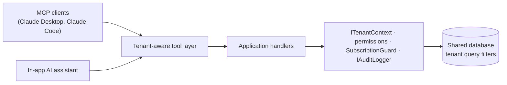

# Roadmap: MCP, AI and beyond

This plan builds on the multi-tenant foundation (tenants, memberships, permissions, audit log, subscriptions, impersonation).

## Guiding principle: one tool layer, two consumers

Build **one set of tenant-aware "tools"**, each a thin wrapper over the existing Application handlers, and expose it twice:

- **MCP server**: external AI clients (Claude Desktop, Claude Code, Cursor, ...) work with a company's real data.
- **In-app AI assistant**: Claude with tool use, calling the same tools.

Every tool call goes through the existing `ITenantContext`, permission policies, `SubscriptionGuard` and `IAuditLogger`. Both consumers therefore get tenant isolation, permission checks, plan limits and auditing for free. There is one security model and one audit trail, and each new capability shows up in both places.

## Ground rules for AI features

- **Drafts first.** AI never sends, finalises or records money on its own. It creates drafts and the user confirms.
- **One tenant per prompt.** Only the active tenant's data ever goes into a prompt, and it is always loaded through the tenant-filtered handlers.
- **Untrusted input.** Invoice notes, client details, uploaded documents and emails are data, not instructions. The assistant can't do anything the user's permissions don't allow, and nothing changes without confirmation (protection against prompt injection).
- **Metered.** AI usage is recorded per tenant and limited per plan.
- **Audited.** AI- and MCP-initiated actions are marked in the audit log, with the token or session they came from.

---

## Phase 0: Foundations

MCP and AI need richer data than the current free-text invoices.

| Item | Details |
| --- | --- |
| Customers | Tenant-owned `Customer` entity (name, address, email, tax number, default currency, payment terms). Invoices reference a customer; the free-text "Bill to" field remains as a snapshot. |
| Products and services | Tenant-owned `Product` entity (name, unit price, tax rate) to pick from on invoice lines. |
| Invoice lifecycle | `Draft → Sent → Paid / Void` alongside the calculated payment status. Only drafts are freely editable. |
| PDF generation | QuestPDF with the tenant's logo, brand colour, tax label and footer. Check that its Community licence (free up to a revenue cap) fits. |
| Real email | SMTP or a provider (e.g. Resend or Postmark) behind `INotificationSender`, sent from a tenant-scoped outbox table so sending is reliable and retried. "Send invoice" emails the PDF. |
| Personal API tokens | Per user and per tenant, with chosen permissions, an expiry date, and hashed storage. Can be created and revoked in the UI. The future MCP and integrations authenticate with them. |
| Payments | A `Payment` entity (date, amount, method, reference) replaces the single `AmountPaid` field (migrated). |
| UI check | Click through all the new multi-tenant screens in a browser, both light and dark themes, at phone width. |

**Done when:** an invoice can be created for a saved customer, emailed as a PDF, and paid in several instalments, and an API token can read invoices.

---

## Phase 1: MCP server

Expose `/mcp` on the API using the official C# MCP SDK (`ModelContextProtocol.AspNetCore`, Streamable HTTP transport).

### Step 1: read-only (low risk, quick to demo)

| Tool | Purpose |
| --- | --- |
| `search_invoices` | Filter by status, customer, date range, text |
| `get_invoice` | One invoice with its lines and payments |
| `list_overdue` | Overdue invoices with days overdue and balance |
| `financial_summary` | Billed, paid, outstanding and overdue per currency, with monthly figures |
| `find_customer` / `get_customer` | Customer lookup with their invoice history |

- **Resources:** company profile and settings, invoice numbering, plan limits.
- **Prompts:** "Month-end review", "Chase overdue invoices", "Customer statement".

### Step 2: write tools (once the drafts workflow exists)

| Tool | Behaviour |
| --- | --- |
| `draft_invoice` | Creates a **draft** with the next invoice number and company defaults |
| `draft_reminder` | Prepares a reminder email for an overdue invoice; nothing is sent |
| `record_payment` | Records a payment; requires the `InvoicesEdit` permission and is audited |

### Authentication and safety

- Step 1 uses Phase 0's API tokens (`Authorization: Bearer`). Step 2 adds OAuth 2.1 with dynamic client registration (as the MCP spec recommends), so users can connect Claude Desktop without pasting a token.
- The tenant and permissions come from the token, never from the tool's arguments.
- Audit entries are marked `via: mcp` with the token's ID. Each tenant and each token gets a rate limit.
- An integration test suite checks that MCP tools can't reach another tenant's data (same approach as the current API tests).

**Example:** in Claude Desktop, *"Which clients owe me more than €1,000 for over 30 days? Draft polite reminders for each."*

---

## Phase 2: AI assistant in the app

The assistant uses Claude through the Anthropic SDK, with the Phase 1 tools as tool definitions. Use the newest Claude models: a capable model for the assistant and a small, fast one for classification and extraction.

| Feature | Details |
| --- | --- |
| "Ask your books" | A chat panel in the tenant app, with answers grounded in tool calls (e.g. "How much did Contoso pay us this year?"). Answers stream back as they're written, with links to the invoices they refer to. |
| Plain-language invoicing | *"12h consulting for Contoso at €95, net 14, 20% VAT"* fills in the invoice editor for the user to review. It never saves on its own. |
| Reminder writer | Drafts a reminder email in the company's tone, getting firmer as the invoice gets more overdue. The user edits and approves. |
| Insights | A short weekly summary: cash coming in, slow-paying clients, unusual changes. It can go into the Phase 0 "weekly summary" notification. |
| Usage and limits | A per-tenant `AiUsage` table (tokens, cost, feature), an `Ai` plan feature with a monthly allowance, and AI cost per tenant on the admin dashboard. |
| Privacy controls | An AI on/off switch in tenant settings, and a clear notice of what data is sent. |

**Done when:** a non-technical user can create a correct draft invoice and an overdue reminder from one sentence each, and every AI action shows up in the activity log.

---

## Phase 3: Document AI

| Feature | Details |
| --- | --- |
| Receipt and expense capture | Photograph or upload a receipt. Claude's vision reads the supplier, date, total, VAT and category, and creates a tenant-owned `Expense` (with the file attached) for the user to confirm. This delivers the "Expenses" item from the original brief. |
| Supplier invoice import | Upload a PDF to get a structured expense or payable. |
| Anomaly checks | Possible duplicate invoices, unusual amounts for a customer, VAT that doesn't match the company's rate, missing invoice numbers. |
| Profit and loss | Reports gain income minus expenses per currency and month. |
| Attachments | Tenant-isolated file storage (database or blob storage with tenant-prefixed paths), with a virus-scan step before storing. |

---

## Phase 4: Getting paid

| Feature | Details |
| --- | --- |
| Online payments | A Stripe payment link or Checkout session per invoice. A signature-verified Stripe webhook creates the `Payment` record and marks the invoice paid. |
| Client portal | A public link per invoice (signed, can expire) where the client views, downloads the PDF and pays. No login needed. |
| Recurring invoices | Schedules (monthly retainer and the like) that create drafts through the existing tenant job runner. |
| Automatic chasing | Scheduled reminder sequences using the Phase 2 writer, with optional approval before each send. |

---

## Phase 5: Running the platform

| Feature | Details |
| --- | --- |
| Billing for your own plans | Stripe Billing connected to the existing plans, trials and expiry. Status changes come in through webhooks. |
| Outgoing webhooks | Per-tenant subscriptions to events (`invoice.created`, `invoice.paid`, ...), signed, with retries, for Zapier or n8n. |
| Live notifications | SignalR, with each tenant in its own group: "Invoice paid", "Reminder sent". |
| Admin analytics | Recurring revenue, active tenants, invoices per day, AI cost per tenant, churn signals. |
| Data rights | Full export of one tenant's data (ZIP of JSON, CSV and PDFs) and a hard delete for GDPR, building on the existing tenant deletion safeguards. |
| Caching | Tenant-prefixed cache keys (e.g. `t:{tenantId}:settings`) when caching is introduced, with a test that no cache key lacks a tenant prefix. |

---

## Suggested order

1. **Phase 0**: customers, invoice statuses, API tokens (PDF and email can follow in parallel).
2. **Phase 1, step 1**: read-only MCP, the fastest impressive demo with almost no risk.
3. **Phase 2**: assistant and plain-language invoicing.
4. **Phase 1, step 2**: MCP write tools, once drafts and approval exist.
5. **Phases 3 to 5**, as product priorities dictate.

## Risks

| Risk | Mitigation |
| --- | --- |
| Data leaking between tenants through prompts or tools | Tools only call the tenant-filtered handlers; the tenant comes from the token or session; cross-tenant MCP tests. |
| Prompt injection from documents or invoice text | Treat that content as data; the assistant has least privilege; every write needs confirmation. |
| AI cost growing out of control | Per-tenant metering, plan limits, a small model for simple tasks, prompt caching. |
| AI writes that are wrong | Drafts only, user review, an audit trail, easy undo (void a draft). |
| OAuth complexity for MCP | Start with API tokens; add OAuth 2.1 once the tools are proven. |
